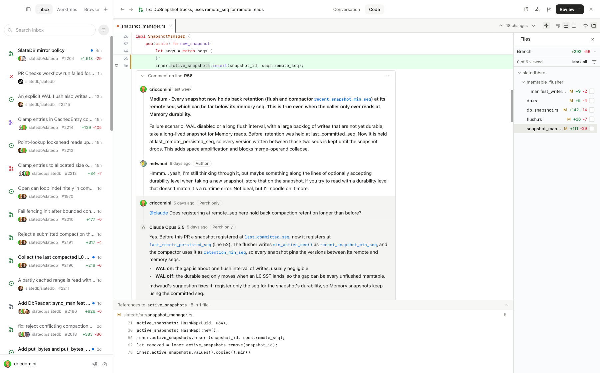

# Perch

I got tired of flipping between github.com, VS Code, and Claude/Codex, so I
made Perch to combine them into one native application.

Features:

* Uses `gh`, `claude`, and `codex` CLIs for everything.
* Fully integrated with GitHub's inbox, PRs, and issues.
* Completely browsable codebase for each PR and code review.
* Language server protocol (LSP) support, so you can "find references",
  "open call hierarchy", and so on.
* Threaded GitHub-style conversations with humans and agents.
* Code walkthroughs for PRs.
* Fully integrated client-side Claude/Codex reviews.



## Install

You need:

- A Mac (Apple Silicon or Intel) or Linux (x86_64 or arm64, glibc 2.35+,
  GTK 3), with git
- The [GitHub CLI](https://cli.github.com/), signed in with `gh auth login`
- For agents: [Claude Code](https://claude.com/claude-code) 2.1.223+ and/or
  [Codex CLI](https://github.com/openai/codex) 0.155.1+, signed in

Then install the latest release. On a Mac:

```bash
gh release download --repo perch-code/perch --pattern Perch-macos-arm64.tar.gz -O - | tar -xz -C /Applications
```

On an Intel Mac, download `Perch-macos-x86_64.tar.gz` instead. Perch isn't
notarized yet, and downloading with `gh` rather than a browser keeps macOS
from quarantining it.

On Linux, unpack it into `~/.local/share/perch` and link the binary onto
your PATH:

```bash
gh release download --repo perch-code/perch --pattern Perch-linux-x86_64.tar.gz -O - | tar -xz -C ~/.local/share
```

```bash
ln -sf ~/.local/share/perch/perch ~/.local/bin/perch
```

On arm64, download `Perch-linux-arm64.tar.gz` instead.

After that, Perch checks for new releases. Click "Restart to update" to
upgrade when one is detected.

## Setup

Configure Perch with `~/.perch/config.toml`. See
[docs/configuration.md](docs/configuration.md) for all settings.

### GitHub

Perch looks for a GitHub token in this order: `GITHUB_TOKEN`, `GH_TOKEN`,
`gh auth token`, then `token` in the config. Apps launched from Finder don't
see your shell's environment, so `gh auth login` is the simplest route.
### Repositories

```toml
[[repo]]
github = "slatedb/slatedb"
root = "~/Code/slatedb"         # your local clone

[[repo]]
root = "~/Code/side-project"    # a local-only repo works too
```

`root` is where Perch finds your branches and worktrees. Removing a
repository leaves its checkouts and worktrees on disk.

## Language servers

Perch starts language servers when you browse a codebase. The following LSPs
are currently supported:

| Language | Server |
|---|---|
| Rust | rust-analyzer |
| Go | gopls |
| TypeScript, JavaScript | typescript-language-server |
| Java | jdtls |
| Python | ty |

Perch will offer to install missing LSPs as needed. rust-analyzer and jdtls
run the checkout's build code, so outside your own work Perch asks before
starting them. To always trust a repository:

```toml
[[repo]]
github = "slatedb/slatedb"
lsp.trust = true
```

## Agent safety

Agents run sandboxed.

- Agents run in "ask" mode (read-only, no network) or "work" mode
  (writable worktree with configurable permissions).
- Agents never get your GitHub token or other secrets from the environment.
- Nothing is posted to GitHub unless you trigger it.

## License

Apache 2.0. See [LICENSE](LICENSE).
