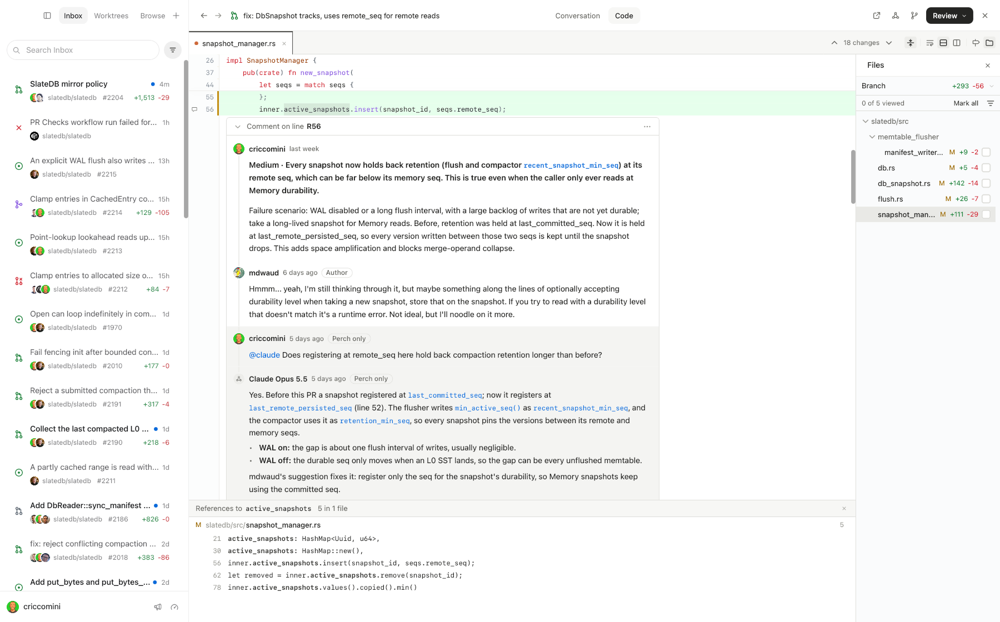

# Perch

I got tired of flipping between github.com, VS Code, and Claude/Codex, so I
made Perch to combine them into one native application.

Features:

* Uses `gh` for GitHub and local coding-agent CLIs for Ask, Work, and Review.
* Fully integrated with GitHub's inbox, PRs, and issues.
* Completely browsable codebase for each PR and code review.
* Language server protocol (LSP) support, so you can "find references",
  "open call hierarchy", and so on.
* Threaded GitHub-style conversations with humans and agents.
* Client-side reviews with Claude Code, Codex, Gemini, or OpenCode.



## Install

You need:

- A Mac (Apple Silicon or Intel) or Linux (x86_64 or arm64, glibc 2.35+,
  GTK 3), with git
- The [GitHub CLI](https://cli.github.com/), signed in with `gh auth login`
- For agents: [Claude Code](https://claude.com/claude-code) 2.1.223+,
  [Codex CLI](https://github.com/openai/codex) 0.155.1+,
  [Antigravity CLI](https://antigravity.google/docs/cli/reference) (`agy`)
  1.5.5+, or [OpenCode](docs/configuration.md#opencode) 2.3.0+, signed in

Then install the latest release:

```bash
curl -fsSL https://raw.githubusercontent.com/perch-code/perch/main/install.sh | sh
```

On a Mac, install.sh puts Perch.app in `/Applications`. On Linux, it unpacks Perch
into `~/.local/share/perch`. Either way it links `~/.local/bin/perch` to it and,
if `~/.local/bin` isn't on your `PATH`, adds it in your shell's startup file
(`~/.zshenv`, `~/.bashrc` or similar). Set `PERCH_NO_MODIFY_PATH=1` to skip that.

The macOS app is signed and notarized by Apple, so you can instead download
`Perch-macos-arm64.tar.gz` (or `-x86_64`) from
[Releases](https://github.com/perch-code/perch/releases/latest), unpack it, and
drag Perch.app to `/Applications`. To run `perch context` from a terminal, link
the CLI yourself and put `~/.local/bin` on your `PATH`:

```bash
mkdir -p ~/.local/bin
ln -sf /Applications/Perch.app/Contents/MacOS/perch ~/.local/bin/perch
```

After that, Perch checks for new releases. Click "Restart to update" to
upgrade when one is detected. On a Mac, permissions you've granted Perch carry
over to new versions.

## Setup

Configure Perch in Settings (`Cmd-,`) or by editing `~/.perch/config.toml`.
Settings writes that file, and Perch takes up edits you make by hand while
it runs. See [docs/configuration.md](docs/configuration.md) for all settings.

### GitHub

Perch looks for a GitHub token in this order: `GITHUB_TOKEN`, `GH_TOKEN`,
`gh auth token`, then `token` in the config. Apps launched from Finder don't
see your shell's environment, so `gh auth login` is the simplest route. With
none of those, Perch asks your login shell as it starts, so a token exported
in a startup file such as `~/.zprofile` or `~/.zshrc` is found too.

GitHub rate-limits each account to 5,000 REST requests an hour, plus a
separate GraphQL budget. Run `gh api rate_limit` to see what's left, and
raise `poll_interval_secs` in the config if Perch is using too much.

### Repositories

```toml
[[repo]]
github = "slatedb/slatedb"
root = "~/Code/slatedb"         # your local clone

[[repo]]
root = "~/Code/side-project"    # a local-only repo works too
```

`root` is where Perch finds your branches and worktrees. Removing a
repository leaves its checkouts and worktrees on disk.

## Language servers

Perch starts language servers when you browse a codebase. The following LSPs
are currently supported:

| Language | Server |
|---|---|
| Rust | rust-analyzer |
| Go | gopls |
| TypeScript, JavaScript | typescript-language-server |
| Java | jdtls |
| Python | ty |

Perch will offer to install missing LSPs as needed. rust-analyzer and jdtls
run the checkout's build code, so outside your own work Perch asks before
starting them. To always trust a repository:

```toml
[[repo]]
github = "slatedb/slatedb"
lsp.trust = true
```

## Agent safety

Agents run sandboxed.

- You choose each agent's permission level: Read only, Ask me, Auto-review,
  or Allow all.
- Agents never get your GitHub token or other secrets from the environment.
- Nothing is posted to GitHub unless you trigger it.

## License

Apache 2.0. See [LICENSE](LICENSE).
