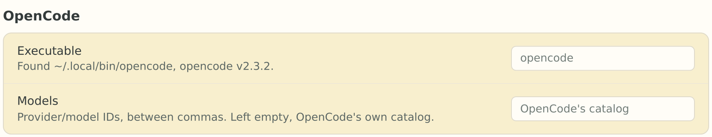

# Configuration

Perch reads `~/.perch/config.toml`, or `$PERCH_HOME/config.toml` when
`PERCH_HOME` is set. Every setting is optional.

### Environment variables and settings on an SSH host

`PERCH_HOME` contains the cache and logs. Only
[one engine](reference.md#one-engine-to-a-perch-home) can use a home at a time.
If another engine owns the directory, Perch reports its process ID. Each engine
reads `config.toml` on the machine where it runs.

`PERCH_SSH` selects the SSH program the desktop app uses for connections,
engine uploads, and remote terminals. For example, it can name a wrapper that
supplies `-F <config>`.

Set `PERCH_IDLE_EXIT_SECS` in the host’s login environment to change how long
the app-started engine waits with no clients or active or queued agent runs.
The default is 900 seconds.

In a [remote environment](reference.md#an-engine-on-another-machine), `[ui]`,
`[display]`, `[keybindings]`, and `[remote]` belong to the desktop app and use
its local file. The engine reads all other settings from the host. Settings
saves each change on the appropriate machine. Adding a repository or fixing the
host’s token triggers the [host checks](reference.md#what-the-app-checks)
again.

### All config.toml keys

Settings changes only the keys you edit and preserves comments. Most edits
apply within seconds. Restart the app for `[display]` or `[ui] code_font`
changes, and restart the engine for `worktrees_dir`. Edit the file directly to
change `token`, `worktrees_dir`, or an existing repository’s `github` and
`root`.

| Key | Default | What it does |
|---|---|---|
| `token` | none | GitHub token to use if the process environment and `gh` provide none. Perch checks again if the token is missing or GitHub rejects it. |
| `poll_interval_secs` | `60` | Shortest time between inbox polls; GitHub can ask for longer |
| `github_host` | none | A GitHub Enterprise host whose remotes count as GitHub |
| `[agent] binary` | `"claude"` | Claude Code executable, a name on `PATH` or a path |
| `[agent] model` | `"opus"` | Model the composer's picker starts on |
| `[agent] effort` | `"high"` | Effort the picker starts on: `low`, `medium`, `high`, `xhigh`, `max` or `ultra` |
| `[agent] models` | `["fable", "opus", "sonnet", "haiku"]` | Claude models the picker offers |
| `[agent] max_concurrent_runs` | `4` | Maximum simultaneous runs. Gemini runs one at a time. Other runs wait. |
| `[agent] sandbox` | `true` | Run Claude Code commands in its sandbox. See [Without Claude Code’s sandbox](reference.md#without-claude-codes-sandbox) for what changes when you turn it off. |
| `[agent.codex] binary` | `"codex"` | Codex executable, a name on `PATH` or a path |
| `[agent.codex] models` | Codex's own list | Codex models the picker offers |
| `[agent.gemini] binary` | `"agy"` | Antigravity CLI executable, a name on `PATH` or a path |
| `[agent.gemini] models` | `agy`'s own list | Gemini models the picker offers |
| `[agent.opencode] binary` | `"opencode"` | OpenCode 2.3.0+ executable, a name on `PATH` or a path |
| `[agent.opencode] models` | OpenCode's own list | Provider-qualified IDs from `opencode models` |
| `[work] branch_prefix` | `""` | Put before branch names Perch fills in, such as `"chris/"` |
| `[work] approvals` | `"auto"` | Who answers a Work run's requests outside its sandbox: `"auto"` (the CLI's auto-reviewer, then you) or `"ask"` (you) |
| `[work] approval_timeout_mins` | `15` in the app, `480` under `perchd` | Minutes a request to you waits before it is denied |
| `[keybindings]` *action* | the action's keys | Keys for an action by its id: a string such as `"super+t"`, a list of them, or `""` for none; see [Keyboard shortcuts](reference.md#keyboard-shortcuts) |
| `[ui] appearance` | `"system"` | `"light"`, `"dark"` or `"system"` |
| `[ui] theme` | `"classic"` | `"classic"`, `"warm-linen"` or `"blue-mist"`. A fresh Perch home starts with `"warm-linen"`. |
| `[ui] code_font` | none | Code font off macOS; on macOS code is always SF Mono; applies after a restart |
| `[display] zoom` | `1.0` | Scales the whole window, `0.75` to `2.0`; applies after a restart |
| `[display] code_font_size` | `12` | Code font size before zoom, `8` to `32`; applies after a restart |
| `clone_root` | `~` | Directory on the SSH host for repositories you add by name, such as `"~/Code"` |
| `worktrees_dir` | `$PERCH_HOME/worktrees` (normally `~/.perch/worktrees`) | Base directory for new Perch-managed branch worktrees. Applies after an engine restart. |
| `[remote] host` | none | SSH host to use when there is no saved window session (for example `"chris@devbox:2222"`). Perch subsequently reopens each window in its last environment. |
| `[remote] command` | none | Custom engine command for the host’s login shell, such as `"perchd bridge"`. By default the app uploads and starts its bundled engine. |
| `[lsp] max_memory_mb` | `8192` | Combined memory budget for language servers. Perch stops idle servers first. |
| `[[knowledge]] dir` | required per entry | External directory relative to `$PERCH_HOME/knowledge/` |
| `[[knowledge]] repos` | every repository | Repositories whose agents may read this directory |
| `[[repo]] github` | none | The repository's `owner/repo` on GitHub; leave out for a local-only repository |
| `[[repo]] name` | the repo's name | Name shown in the sidebar |
| `[[repo]] root` | none | Path to your local clone, where Perch finds branches and creates worktrees |
| `[[repo]] base` | the remote's default | Base branch, when the remote doesn't say |
| `[[repo]] sync_history` | `false` | Keep the repository's GitHub issues, pull requests and discussions available to agents |
| `[repo.work] write` | `[]` | Extra directories Work runs may write, such as a package cache |
| `[repo.work] network` | `[]` | Hosts Work runs may reach, such as `index.crates.io` |
| `[repo.work] approvals` | `[work] approvals` | Overrides it for this repository; also takes `"never"`, which allows every request |
| `[repo.work] trust` | `false` | Load the repository's own `.claude/`, `.mcp.json`, `.codex/` and `.agents/` config for Work runs |
| `[repo.lsp] trust` | `false` | Start rust-analyzer and jdtls on anything in this repository without asking |

The [reference](reference.md) covers what each setting does in more detail.

## Worktree directory

Add `worktrees_dir` as a top-level key in `config.toml` on the machine
running the engine, then restart the engine.

```toml
worktrees_dir = "~/.herdr/worktrees"
```

`~` expands to the engine user’s home. Relative paths start at `PERCH_HOME`
(usually `~/.perch`). Changing this setting affects only new worktrees.
Existing checkouts stay where they are, and Perch leaves unrelated directories
alone.

## GitHub history

Turn on **Sync GitHub history** in a GitHub repository's card under
**Settings → Repositories**, or set `sync_history = true` in its `[[repo]]`
entry on the engine's machine.

```toml
[[repo]]
github = "slatedb/slatedb"
root = "~/Code/slatedb"
sync_history = true
```

The engine downloads open and closed issues, PRs, and their discussions into
the [repository archive](reference.md#repository-history-for-agents). It
refreshes at startup and about once an hour while the engine runs. You can
close the desktop app while a remote engine continues syncing.

## External knowledge

Add directories in **Settings → Knowledge** or in the engine's
`config.toml`.

```toml
[[knowledge]]
dir = "discord/slatedb"
repos = ["slatedb/slatedb", "slatedb/slatedb-go"]

[[knowledge]]
dir = "notes"
```

List GitHub repositories as `owner/repo` or local repositories as
`local/<name>`. Names are case-insensitive. Omit `repos` to share the directory
with every repository, or use an empty list to share it with none. In Settings,
turning off **All repositories** starts with an empty list.

Put Markdown on the machine running the engine. An optional `INDEX.md` gives
agents a starting point. Links to original messages or documents let them check
a source. Use regular files and directories without symlinks or instruction
files such as `AGENTS.md`, `CLAUDE.md`, or `GEMINI.md`. Perch reserves the
top-level names `perch` and `reviews`.

Start a new Ask, Work, or Review session to use a newly shared directory. Perch
treats its contents as untrusted reference material. You or the tool that
supplies the files must keep them up to date.

Settings explains why a directory was skipped. Common reasons include a missing
folder, a symlink or agent instruction file anywhere inside, more than 200,000
entries, or an agent that cannot accept the directory. The engine logs changes
and caches each check for up to a minute. After a fix, try a new run once that
minute has passed.

## OpenCode

In **Settings → Agents → OpenCode**, check that Perch found the executable
on the machine with your checkout. Leave **Models** empty to use OpenCode’s
catalog, or enter the models you want in the picker.



Sign in on that machine with the command below, then restart Perch to refresh
the picker. Perch uses its own OpenCode profile so an “always allow” decision
from your terminal can’t approve a command in Perch.

```sh
perch_home="${PERCH_HOME:-$HOME/.perch}"
OPENCODE_DB="$perch_home/opencode/opencode.db" OPENCODE_CONFIG_DIR="$perch_home/opencode/config" opencode auth login --standalone
```

Custom provider configuration goes in `$perch_home/opencode/config/opencode.json`.
OpenCode Zen also accepts `OPENCODE_API_KEY` in the engine's environment.

Ask and Review have read and search tools. Work allows worktree edits and sends
shell commands through Perch's approval controls. Perch disables project
configuration, plugins and MCP servers for these sessions. When the model
offers the selected effort variant, Perch uses it. Otherwise OpenCode uses
the model's default.
