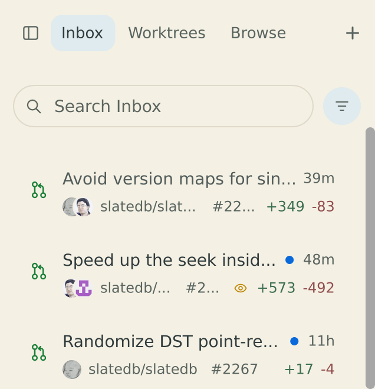
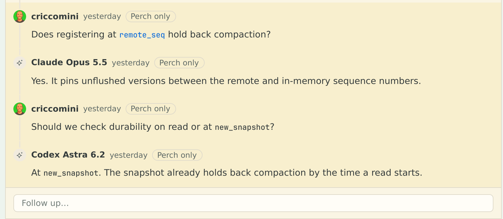
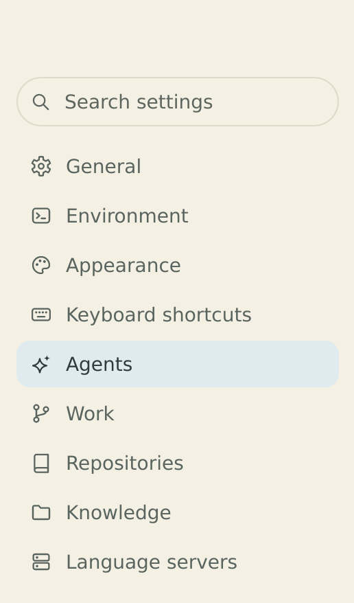
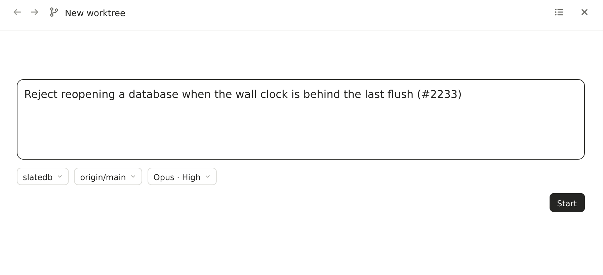
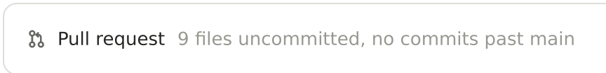
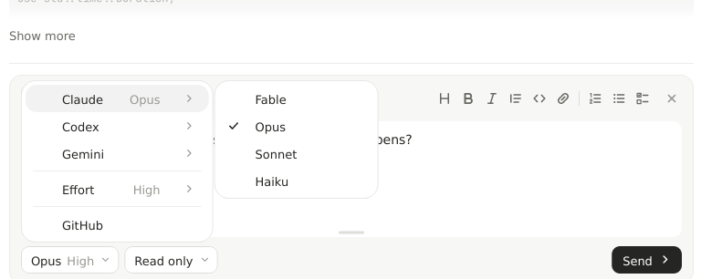
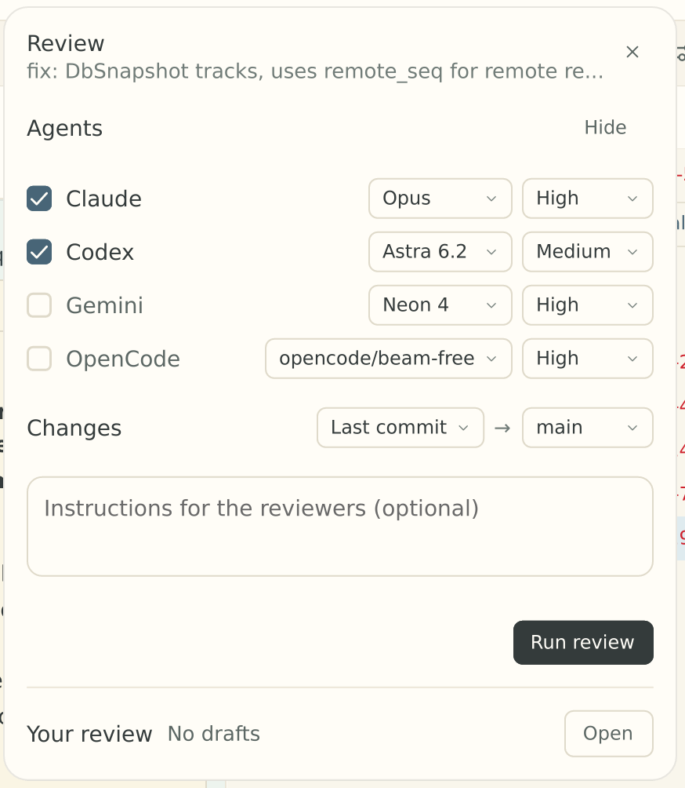
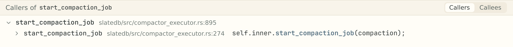
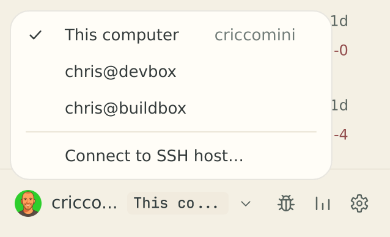

# Perch reference

Perch is a native app for macOS and Linux. Use it to work on GitHub issues,
browse code, and review pull requests with your team and coding agents.

## GitHub inbox

### When the inbox refreshes

Open **Inbox** for your GitHub notifications in GitHub’s order. Perch shows cached threads immediately, including ones you’ve read,
and remembers Done and Snooze even if it can’t update the cache.



Click **Refresh** to bring new notifications into the list. Read indicators
update in place. If the open discussion changes, Perch offers to reload it.
CI results update automatically for the commit you’re viewing.

Perch polls at GitHub’s requested interval (`X-Poll-Interval`). It fetches all
pages at startup and on the first poll after 15 minutes. Between full checks,
it tests the first page’s `ETag`. Changes to older threads on github.com can
take until the next full check to appear. A new login takes effect on the next poll.

### Read state, Done, and snoozing

- **Read.** Opening an issue or PR from any sidebar tab marks it read on
  GitHub. Perch highlights the latest activity covered by an unread
  notification, opening a resolved thread if needed. Scroll to keep your
  place. Read threads reopen where you left them.
- **Mark Unread** sets a local reminder until you open the item. GitHub’s API
  cannot mark a thread unread. Perch remembers which update you read until
  new unread activity arrives.
- **Done** clears the notification in Perch and on GitHub. New unread activity
  brings it back. Your own comments and updates you’ve read leave it under
  Done. Perch checks for newer activity before clearing, but a comment arriving
  between that check and GitHub accepting Done can still be cleared.
- **Unsubscribe** also tells GitHub to ignore future activity on that thread.
- **Snooze** hides a thread in Perch until the time you choose or new unread
  activity arrives. Later today means 6 PM. The other presets use 8 AM. If no
  update arrives, the thread returns with its previous read state.

**Move to Inbox** restores a thread from **View › Snoozed** or **View › Done**.
Done lists cleared threads GitHub still returns. Restoring one affects Perch
only, until it qualifies for Done again.

When you merge or close a PR or close an issue, Perch treats the next minute’s
activity as part of the close and marks the thread Done. Later unread comments
bring it back. When someone else closes the item, its notification stays put.

To clear finished items together, choose **State › Merged or Closed**, then
**Mark N Done**. Perch skips threads with newer unread activity and reports
failures together. Unknown states, releases, and CI runs count as open.
In Done and Snoozed, the bulk action is **Move N to Inbox**.

Issues and PRs open in Perch. Other notification types open on GitHub.

### The sidebar's filter menus

Use the filter beside the search box to choose a view, repository, state, or sort order.

- **Inbox** shows active, snoozed, or done notifications. Filter by unread
  status or reason (review requested, yours, assigned, or mentioned). **Yours**
  includes items you opened. Sort newest or oldest first.
- **Worktrees** lists your worktrees. **Recent** lists everything you’ve
  opened. Each view remembers its sort order (last activity, last opened, or
  created). Both have an unread filter.
- **Browse** searches GitHub for items you own, need to review, were assigned,
  or were mentioned in. **All** searches the selected repository or all
  configured GitHub repositories. Sort by last activity or creation date.

The repository filter applies across tabs and includes repositories known from
Inbox or Worktrees. State defaults to **Any** in Inbox and Worktrees and
**Open** in Browse. Choose **Merged or Closed** for finished items.

Clearing a notification keeps its worktree and conversation. GitHub’s API can
return Done history without identifying which threads are in its web inbox, so
the two Done views can differ.

### Finished runs on your own work

When an agent finishes an Ask, Work, or review run on a worktree without a pull
request, Perch adds a local notification. The row names the repository, branch,
and result, such as `Claude · Work · 3 files` or `Review · 2 findings`.
Failures use the error color. Perch skips runs you were watching in the
foreground, canceled runs, runs interrupted when you quit, and sessions started
outside Perch.

Each worktree gets one inbox row for its most recent result. Open the item to
mark it read, choose **Mark Unread** for a reminder, or choose **Done** to hide
it until another run finishes. Look under **View › Inbox** with **Yours** or
**All** selected. Local rows appear in time order alongside GitHub notifications
and have no Snooze option.

Once the worktree has a pull request, its local row disappears. GitHub supplies
its inbox notifications from then on. Perch still shows a notice when a run
finishes.

Perch fetches a pull request or issue when you open a notification or open
the item by repository and number. For agents, you can also enable
[GitHub history sync](configuration.md#github-history) per repository.

## Conversation and Code

At the top of an item, choose **Conversation** to read its description,
timeline, and threads, or **Code** to open its files. In Code, file tabs sit
above the editor and the [file tree](#the-file-tree) opens on the right.

On an issue, **Code** shows a read-only checkout of the repository’s default
branch. Perch creates it when you first open an issue in that repository. The
file tree shows the branch, commit, and last fetch time. Use its refresh button
to fetch now. Opening an issue also fetches, at most once per minute per
repository.

Issues in the same repository share this checkout. A fetch updates all their
open files. Click a file mentioned in the issue or use `Cmd-P` to find it. To
edit the code, choose **Start Work** for a [separate worktree](#work).

New items open in Conversation. Until you quit, each item remembers its view and
open tabs. Closing the last file leaves you in Code. Switch back to Conversation
when you want to reply.

| Action | Key |
|---|---|
| Conversation, Code | `Cmd-Shift-1`, `Cmd-Shift-2` |
| Next, previous file tab | `Cmd-}`, `Cmd-{` |
| Close the file | `Cmd-W` |
| The file tree | `Cmd-/` or `Cmd-Shift-E` |
| Agents | `Cmd-Shift-A` |

See [Keyboard shortcuts](#keyboard-shortcuts) for the full list and how to
change a binding.

## Timeline

Conversation shows the description, comments, reviews, and GitHub events in time
order. Each event shows who acted and when. You can see commits, label and
assignment changes, review requests and dismissals, renames, milestones,
force-pushes, linked issues and PRs, and when an item opened, merged, or closed.
A commit shows its short SHA, subject, and the author name Git recorded.

Comments and reviews each appear once. Perch skips unknown events and events
GitHub hides from its own timeline, such as `mentioned` and `subscribed`. It
reads up to ten pages of 100 entries per item.

## Reactions

Click a reaction below a description, comment, or review to add yours. Click it
again to remove yours. Blue means you’ve reacted. Hover over the count to see
who else reacted (up to ten names), or click the smiley to choose from all eight
GitHub reactions. Perch updates the count right away and restores it if GitHub
rejects the change.

Perch fetches reactions with the discussion in batches of 100 through GitHub’s
GraphQL API. Older cached discussions show reactions after their next refresh.

## Posting

Choose a model to ask a private question or **GitHub** to reach the author.
A GitHub line comment becomes a review draft. At the bottom of Conversation,
a GitHub comment posts when you confirm.

Type `@` to mention a participant, another repository user, or a file, in that
order. Your own account is excluded. Move with the arrows or `Ctrl-N` and
`Ctrl-P`, select with Enter or Tab, or dismiss with Escape. People appear as
`@login`. Files appear as `@path` for agents or a code-formatted path on
GitHub that opens in Perch.

Message boxes start at five lines and grow as you type. Drag the bottom edge
to set a height (about 2–24 lines) for all boxes until you quit.

### Offline review drafts

On a line of a file, or under a GitHub review thread, choose **GitHub** to save
a draft. You can edit or delete it, close Perch, or work offline. The **Review**
button counts your drafts. Open it to check the comments and choose a verdict. A
**Comment** review with drafts can have an empty summary.

When you submit, replies go under their original threads and comments on an
older commit stay on that commit. For a comment on the current commit, GitHub’s
API requires the entire selection to fall within one diff hunk (changed lines or
the three surrounding lines). Perch identifies out-of-range drafts and submits
the rest. A draft stays local if GitHub rejects it or Perch cannot confirm it
was posted.

### Inline suggestions

Select lines and click **Suggest**. Edit the prefilled `suggestion` block to
show what the lines should say. On a worktree without a PR, sending just that
block applies your edit directly to the file. The edit appears under
**Uncommitted**. If the original lines have changed, Perch keeps your draft and
explains why it couldn’t apply it. Add text outside the block to send it to the
agent as a message instead.

On an open PR, **Apply suggestion** lets you commit a GitHub suggestion to the
PR branch. Edit the default message (`Update <path>`), optionally add a
description, and click **Commit changes**. Perch checks that the branch and
target lines still match and resolves the thread if GitHub permits. Pull to
bring the commit into your local worktree.

The button is disabled offline, on a resolved thread, or when the suggestion
makes no change. It’s absent on drafts, outdated threads, and closed PRs.

### Comments and closing items

At the bottom of **Conversation**, choose **GitHub** and click **Comment** to
post after confirmation. To quote the description, a review summary, or a
comment, hover over it and choose **Quote reply**. Select a passage first to
quote just that text. Perch appends the quote to anything you’ve already typed
for GitHub.

On an open PR you authored or can write to, **Close with comment** posts your
comment and closes the PR. With an empty box it reads **Close pull request**. On
an issue you authored or can triage, use the arrow beside **Close issue** to
choose **Close as completed**, **Close as not planned**, or **Close as
duplicate**. For a duplicate, pick the original issue and check its number in
the confirmation. The button remembers your choice until you switch items.

To keep track of a bug from a PR you’re closing, choose **Close as issue…**.
Edit the proposed issue title and body and the closing comment. The body
includes a reference such as `Found in #12.` and `{issue}` in the comment
becomes the new issue number. **Write with Claude** or **Codex** can draft a
description of the bug on the base branch. Perch asks before replacing your
edits.

Choose **Open issue and close** to create the issue, comment on the PR, and
close it. If GitHub refuses the comment or close after creating the issue, Perch
reports which step failed. It won’t create a second issue.

### Review threads and Perch-only replies

Hover over a GitHub comment and choose **Ask about this** for a private
question or **Reply** for GitHub feedback. You can bring several agents into
the same thread. Their replies carry the **Perch only** label.



**Post to GitHub** lets you edit an answer and send it under your name. On a
GitHub review thread it becomes a draft. Without a GitHub line or thread it
posts as an issue comment. **Quote reply** copies all or part of an answer into
a private follow-up. **Copy** puts an answer’s markdown on the clipboard,
including while the agent is still answering or after a stopped or failed run.
[Agent review findings](#worktree-reviews) start as drafts.

In Code, the thread sits under the relevant lines. Conversation shows the file
and line numbers. In a split diff, `L12` refers to the old file and `R12` to
the new one.

**Resolve** and **Unresolve** take effect immediately on GitHub when you have
permission. Perch restores the previous state if GitHub rejects the change.
Resolving a Perch-only thread affects only Perch. Review findings use
**Dismiss** and **Reopen**. A published finding can also be resolved on GitHub.

Resolved threads collapse. Use **Show resolved** or **Hide resolved** separately
in Code and Conversation, or use a thread’s chevron to collapse just that
thread.

## Authentication

### Where Perch looks for a token

Perch calls GitHub's API directly. It uses the first token it finds in this
list.

1. `GITHUB_TOKEN`
2. `GH_TOKEN`
3. `gh auth token`
4. `token` in `~/.perch/config.toml`
5. `GITHUB_TOKEN`, then `GH_TOKEN`, as your login shell exports them

### Signing in from the desktop

If you open Perch from Finder or the Dock, it may miss variables you export in
your terminal. Run `gh auth login` once to sign in from both places. Perch
picks up a new GitHub CLI login or a change to the `token` setting on its next
poll.

If the first four sources return nothing, Perch starts `$SHELL` as an
interactive login shell and waits up to five seconds for the two variables. It
tries this once per launch. Restart Perch after adding an export to your shell
profile.

### Required GitHub permissions

Your token needs permission to read your repositories and to read and update
notifications. Other actions need write access on the repository where you take
the action.

- `Contents: write` lets you merge a pull request or push a branch from a clone
  Perch manages.
- `Pull requests: write` lets you open a pull request, comment, approve,
  request changes, resolve a thread, or add a reaction to a PR or its comments.
- `Issues: write` lets you react to an issue, close it, or use **Close as issue**.

## Configuration

Perch reads `~/.perch/config.toml` (or `$PERCH_HOME/config.toml`). A repository
entry can name a GitHub repository, a local clone, or both.

```toml
poll_interval_secs = 60

[[repo]]
github = "slatedb/slatedb"
name = "slatedb"
root = "~/Code/slatedb"
```

Set `name` for the sidebar label and `root` to the path of your clone. Perch
scans that clone for local branches and worktrees. Scanning leaves GitHub
history alone. A worktree without a PR appears under **Authored**. Once it has
a PR, the PR author determines where it appears. The base branch has no row. A
local-only repository appears as `local/<name>` and supports worktrees and
agents.

To keep a discovered worktree out of the sidebar, choose **Hide**. Find it under
**Recent** and choose **Unhide** to bring it back. Deleting its row only hides
it until the next scan because Perch leaves the checkout on disk.

If you rename a branch with `git branch -m`, Perch uses Git’s reflog to keep
its threads, runs, and hidden state together. Switching branches, renaming onto
a branch with its own row, or renaming a branch attached to a PR leaves the
history with the old row.

### Work, language servers, and appearance

Use `[work]` for [new worktree](#starting-work) defaults and `[repo.work]` for
permissions on a particular repository.

```toml
[work]
branch_prefix = "chris/"       # before a branch name Perch fills in
approvals = "auto"             # or "ask"; see Approvals

[[repo]]
root = "~/Code/perch"

[repo.work]                    # what a Work run here may reach
approvals = "never"            # over [work]'s, for this repository only
write = ["~/.cargo/registry", "~/.cargo/git", "~/.cargo/.package-cache"]
network = ["index.crates.io", "static.crates.io"]
trust = false                  # true loads the repository's own agent config
```

The `write` and `network` lists start empty. Grant write access to the specific
cache directories an agent needs. For example, granting the whole `~/.cargo`
directory would also let it change your Cargo configuration and binaries. Perch
skips entries that include your home directory or `~/.perch`, and paths in or
containing a configured root’s `.git` directory. It reports skipped entries at
startup.

When you leave an item, Perch keeps up to two idle language servers for ten
minutes so you can return without waiting for the workspace to load. Set the
combined memory budget under `[lsp]`.

```toml
[lsp]
max_memory_mb = 8192           # the default
```

Over budget, Perch stops the oldest idle server first. Servers for open views
can use more than the budget on their own.

Use `[display]` to change the size of the interface. Restart Perch to see the change.

```toml
[display]
zoom = 1.0                     # the default; 0.75 to 2.0
code_font_size = 12            # the default; 8 to 32
```

`zoom` scales the whole window. For example, `1.25` makes text, icons, and
spacing 25% larger. `code_font_size` sets the editor text size before zoom,
including headers, hovers, and references. Comments and agent replies follow
the window zoom.

Use `[ui]` for the theme, light or dark appearance, and code font.

```toml
[ui]
appearance = "dark"            # "light", "dark" or "system", the default
theme = "warm-linen"           # "classic", "warm-linen" or "blue-mist"
code_font = "Fira Code"        # off macOS only
```

Choose a theme in Settings → Appearance to preview and apply its palette.
Each theme has a light and a dark version. Perch starts with Warm Linen in a
fresh Perch home and uses Perch Classic when `theme` is absent.

By default, Perch follows the system appearance. On Linux under X11 it starts
light because X11 does not supply the setting. Choosing light or dark applies
immediately. Choosing `"system"` applies the current system appearance
immediately. Restart Perch to follow subsequent system changes.

On macOS, the code font is SF Mono. On Linux, set `code_font` and restart.
Otherwise Perch uses the first installed font from JetBrains Mono, DejaVu Sans
Mono, Noto Sans Mono, Liberation Mono, Adwaita Mono, and Droid Sans Mono.

Loading a Rust or Java project can run code from the checkout. `rust-analyzer`
runs build scripts and proc macros and reads `.cargo/config.toml` and
`rust-toolchain.toml`. `jdtls` can run Gradle or Maven. On your own work in a
configured repository, Perch starts these servers automatically. That includes
branches in your local root, even if you checked one out from a fork, the
default branch for an issue, and your PRs from the configured repository or
your fork.

On another person’s PR, a branch created from it, or an unconfigured repository,
Perch asks first. Choose **Trust and start** to trust this item, including
future commits pushed to it. Deleting the item clears that decision. Branches
you created from PRs before upgrading may ask once.

To trust one server throughout a repository, select its **Always trust**
checkbox when you confirm. The Worktree row also offers **Trust and Start**,
**Always Trust**, and **Stop Trusting**. Revoking repository trust stops that
server on items with no other trust decision. Go and TypeScript servers can
start without this prompt. To allow all language servers across a repository,
including other people’s PRs, use the following setting.

```toml
[[repo]]
github = "slatedb/slatedb"

[repo.lsp]
trust = true                   # false, the default, asks as above
```

`~/.perch` contains the database, avatars, managed clones, worktrees, and agent
state. The database includes local conversations and review drafts. GitHub can
supply fresh notifications, but it has no copy of those local records.

Database upgrades keep conversations, agent attempts, session IDs, and activity
history. If an upgrade fails, the original database stays in place. Perch
refuses to open a newer or unsupported format.

## Settings

### Sections and search

Click the sidebar gear or press `Cmd-,` (`Ctrl-,` on Linux). Search across all
settings or choose a section.



Escape clears a search, then closes Settings. Back and Close also dismiss it
(`Cmd-[` and `Cmd-W` by default). See [Keyboard shortcuts](#keyboard-shortcuts)
to change a binding.

### Save or reset a setting

**This window** changes the environment for that window alone. Other
preferences save to `config.toml`. Perch changes just the key you edit and
preserves your comments. Press Enter or leave a text field to save. Escape
restores the saved value. The reset arrow removes the key so its default
applies again.

Use **Repositories** to add or remove a clone. Under **Knowledge**, add or
remove directories and choose which repositories can use them.

You can also edit the file directly. Perch checks it every two seconds. If it
finds invalid TOML, it keeps your last working settings and pauses edits in
Settings. Choose **Open in editor** to fix the file.

Most changes take effect immediately. Perch checks installed agents again when
you change an executable or model list. Lowering **Runs at once** lets active
runs finish before starting more. Turning off **Start language servers without
asking** restores prompts for code that needs trust. Zoom, code size, and font
changes take effect after a restart. Settings marks them and offers to restart
Perch.

## Keyboard shortcuts

### Customizing keybindings

Open **Settings → Keyboard shortcuts** to change a shortcut. To assign several
keys to one action, edit `[keybindings]` in `config.toml`. Use the action ID
from the tables below. A string assigns one key, a list assigns several, and
`""` or `[]` clears them. Your assignment replaces all defaults for that
action.

```toml
[keybindings]
go_to_file = "super+t"          # Go to File on Cmd-T, and no longer on Cmd-P
pin = ""                        # no key; [] does the same
refresh = ["super+r", "f5"]     # two keys for one action
toggle_sidebar = 'super+\'     # a backslash in single quotes, or "super+\\"
```

Join the modifiers and the key with `+`. Capitalization doesn’t matter.

- Modifiers: `super` (also `cmd`, `command` or `meta`), `ctrl` (or
  `control`), `alt` (or `option`) and `shift`. `super` is the command key:
  Cmd on macOS, Ctrl elsewhere, so off macOS `ctrl+p` and `super+p` are the
  same key.
- Keys: a letter, a digit, punctuation as a US keyboard has it
  (`` [ ] \ / , . ; ' = - ` ``), `enter`, `escape`, `tab`, `space`,
  `backspace`, `delete`, `up`, `down`, `left`, `right`, `pageup`,
  `pagedown`, `home`, `end`, `f1` to `f20`, or a key's code as floem names
  it, such as `KeyH` or `NumpadEnter`. Keys are physical: `shift+]` is the
  key a US keyboard writes `}` with, wherever your layout puts it.
- A backslash is an escape in a TOML string in double quotes, so write
  `super+\` as `"super+\\"`, or as `'super+\'` in single quotes. `"super+\"`
  leaves the string open, and Perch can't read any of `config.toml` then.

Modifiers must match exactly. For example, `super+g` does not match
Cmd-Shift-G. Perch reports unknown action IDs or invalid keys and applies the
other entries.

A printable shortcut without Cmd, Ctrl, or Alt works only outside text fields.
For example, `/` focuses sidebar search while reading a PR, but types a slash
when you’re writing a comment.

Settings flags shortcuts that compete in the same place. Some can share a key.
For example, `super+g` adds a suggestion while composing a line comment and
finds the next match in the editor. Window actions such as **New Work**,
**Close**, **Go to File**, and **Toggle Files** also work inside a message box
and take priority there.

Menus and tooltips show the first shortcut assigned to an action. On macOS, the
application menu displays the first shortcut for **New Window**, **Open…**, and
**Settings…** unless it’s a plain typing key. Additional bindings still work in
the window.

These stay as they are: `Escape`, `Enter`, the arrows and `Tab` inside
menus, Go to File, pickers, dialogs and the find bar; the text keys of boxes
and the editor, `Cmd-C`, `Cmd-A` and the like; `Cmd-Enter`, which sends or
submits; `Cmd-click` on a symbol; the mouse's back and forward buttons; the
single letters of an open item menu; and the keys macOS keeps, `Cmd-Q`,
`Cmd-H`, `Cmd-Opt-H`, `Cmd-M`, `` Cmd-` `` and `Cmd-Tab`. Settings won't take
these macOS keys for an action. An action given `Cmd-Q`, `Cmd-H`,
`Cmd-Opt-H` or `Cmd-Tab` by hand never runs, as macOS has them first, and
Settings says so on its row.

In Settings, click an action’s shortcut (or focus it and press Enter or Space),
then press the new key. Escape cancels. Click × to clear all bindings for that
action or the reset arrow to restore its defaults. Use the configuration file if
you want several bindings for one action.

Hold Command on macOS or Ctrl on Linux to see shortcuts on the sidebar and view
tabs and on toolbar buttons. Narrow toolbars hide hints when space is tight.
Custom shortcuts take priority over the default Inbox, Worktrees, and Browse
keys.

### Default shortcuts by view

The tables use the same groups and action IDs as Settings.

**General**

| Action | Default | What it does |
|---|---|---|
| `new_work` | `super+n` | Opens the new worktree form |
| `new_window` | `super+shift+n` | Opens another window |
| `open` | `super+o` | Opens a pull request or issue from its link or number |
| `settings` | `super+,` | Opens Settings |
| `close` | `super+w` | Closes Settings, the active file, the item, or the window, in that order |
| `back` | none | Closes Settings or returns to the sidebar from an item or New Work |
| `history_back` | `super+[` | Goes back to where you were |
| `history_forward` | `super+]` | Goes forward again after going back |
| `toggle_agents` | `super+shift+a` | Shows or hides the list of agent runs |
| `send_feedback` | none | Opens or closes Send Feedback |

**Sidebar**

| Action | Default | What it does |
|---|---|---|
| `toggle_sidebar` | `super+\` | Shows or hides the sidebar |
| `focus_search` | `super+shift+f`, `/` | Opens the sidebar and focuses its search box |
| `inbox` | `ctrl+1` (macOS), `alt+1` (other) | Shows the Inbox, opening the sidebar if needed |
| `worktrees` | `ctrl+2` (macOS), `alt+2` (other) | Shows Worktrees, opening the sidebar if needed |
| `browse` | `ctrl+3` (macOS), `alt+3` (other) | Shows Browse, opening the sidebar if needed |
| `next_item` | `j` | Opens the next sidebar item, or the first if none is open. Skips browser-only notifications. |
| `previous_item` | `k` | Opens the previous sidebar item |
| `mark_done` | `e` | Marks the Inbox row under the pointer done, else the open item's row |
| `mark_unread` | `shift+u` | Marks the Inbox row under the pointer unread, else the open item |
| `pin` | `p` | Pins or unpins the row under the pointer, else the open one |

**Item**

| Action | Default | What it does |
|---|---|---|
| `show_conversation` | `super+1` | Shows the open item's Conversation |
| `show_code` | `super+2` | Shows the open item's Code |
| `next_tab` | `super+shift+]` | Goes to the next file tab, `Cmd-}` on a US keyboard |
| `previous_tab` | `super+shift+[` | Goes to the file tab before, `Cmd-{` |
| `refresh` | `super+r` | Fetches the open item from GitHub again |
| `open_on_github` | `super+shift+o` | Opens the row under the pointer, else the open item, in the browser |
| `copy_link` | `super+shift+c` | Copies the open item's link |
| `copy_branch_name` | none | Copies the open item's branch name |
| `start_work` | none | Starts work on the open item |
| `toggle_review` | `super+shift+r` | Opens or closes Review when available |
| `toggle_merge` | `super+shift+m` | Opens or closes Merge when available |

**Conversation & Code**

| Action | Default | What it does |
|---|---|---|
| `comment` | `a` | Comments on the selected lines on Code, or on the item as a whole on Conversation |
| `page_up` | `pageup` | Scrolls up a page |
| `page_down` | `pagedown` | Scrolls down a page |
| `scroll_to_top` | `super+up` | Scrolls to the top |
| `scroll_to_end` | `super+down` | Scrolls to the end |

**Code**

| Action | Default | What it does |
|---|---|---|
| `go_to_file` | `super+p` | Opens Go to File. Press again to select the next result. |
| `toggle_files` | `super+/`, `super+shift+e` | Shows or hides the file tree |
| `next_change` | `]` | Goes to the next change in the file |
| `previous_change` | `[` | Goes to the change before |
| `toggle_viewed` | `v` | Marks the active file viewed or unviewed |
| `next_unviewed` | `shift+]` | Goes to the next file not yet viewed |
| `previous_unviewed` | `shift+[` | Goes to the previous unviewed file |
| `toggle_wrap` | none | Turns Word wrap on or off |
| `go_to_definition` | `f12` | Goes to where the symbol at the caret is defined |
| `go_to_type_definition` | none | Goes to where the symbol's type is defined |
| `go_to_implementations` | `super+f12` | Lists what implements the symbol |
| `find_references` | `shift+f12` | Lists where the symbol is used |
| `call_hierarchy` | `alt+shift+h` | Shows what calls the function, and what it calls |

**Find**

| Action | Default | What it does |
|---|---|---|
| `find` | `super+f` | Opens the find bar on the code or Conversation |
| `find_next` | `super+g` | Goes to the next match |
| `find_previous` | `super+shift+g` | Goes to the match before |
| `find_match_case` | `alt+super+c` | Turns match case on or off, while the bar is up |
| `find_whole_word` | `alt+super+w` | Turns whole word on or off, while the bar is up |
| `find_regex` | `alt+super+r` | Turns regular expressions on or off, while the bar is up |

**Composer**

| Action | Default | What it does |
|---|---|---|
| `bold` | `super+b` | Makes the selection bold |
| `italic` | `super+i` | Makes the selection italic |
| `code` | `super+e` | Makes the selection code |
| `link` | `super+k` | Makes the selection a link |
| `quote` | `super+shift+.` | Quotes the selected lines |
| `numbered_list` | `super+shift+7` | Makes the selected lines a numbered list |
| `bullet_list` | `super+shift+8` | Makes the selected lines a list |
| `task_list` | `super+shift+l` | Makes the selected lines a task list |
| `suggest` | `super+g` | Adds a suggestion, in a comment on lines of code |
| `toggle_preview` | `super+shift+p` | Switches between Write and Preview |

## Starting work

### Create a worktree

Click `+` in the sidebar or press `Cmd-N` to give a branch its own checkout.
Choose a repository and base, then describe the task.



**Start** creates the worktree and sends your task to the agent. The first
line names the item. For an empty checkout, leave the message blank and click
**Create worktree**. Closing the form keeps your draft until you quit.

- **Repository** defaults to the current or last-used repository. The menu
  follows configuration order, marks local-only repositories, and lets you add a folder.
- **Base** lists local and remote-tracking branches from your clone, or
  branches from GitHub when there’s no local clone.
- **New branch** combines `branch_prefix` and the first five words of your
  task. Perch adds a suffix to resolve a generated name conflict. If you typed
  the name, it asks you to choose another.

Worktrees go under `~/.perch/worktrees/` by default, named for the
repository and the branch. To put new worktrees elsewhere, set
[`worktrees_dir`](configuration.md#worktree-directory).

When you choose a repository with a local root in **New worktree**, Perch
creates the branch in your clone. Run `git worktree list` there to find the
checkout. It shares your remotes and Git configuration. Perch fetches the base
branch using your credentials. If Git needs an interactive password or
passphrase, Perch uses the base already on disk and tells you its age.

In your clone, Perch creates the branch and worktree record, fetches the base,
deletes the branch when you choose **Delete**, and pushes and sets its upstream
when you open a PR or choose **Push**. A GitHub repository without a local root
uses a clone managed by Perch. **Start Work** on a GitHub issue or PR also uses
Perch’s clone. Starting from a local worktree uses that repository.

### Start work from an item

Open an item’s details and choose **Start Work** on the Worktree row or its
menu. You can also use the sidebar row’s menu, including on an issue or PR
notification. The starting branch depends on the item.

- **Issue.** Perch creates `perch/issue-<n>` from the default branch.
- **Pull request.** Perch creates `perch/pr-<n>-work` from the PR checkout,
  including unpushed commits, or from the head on GitHub if there’s no
  checkout. The diff uses the original PR’s base, so it includes the original
  changes. This also works on forks and other people’s PRs.
- **Worktree.** Perch starts from its current commit and adds a suffix such as
  `-2` to the branch name.

For an issue or PR, Perch prepares a prompt in the new worktree. Click **Start
Work** on the original item again to reopen the same worktree, or find it under
**In Perch**. A PR opened from it includes `Closes #<n>` so merging closes the
original issue or PR. Merged PRs and archived items have no **Start Work**
action.

Starting from a notification opens or creates its Perch item first. The action
is disabled once Perch sees that the PR merged or the issue closed. If you
removed the PR’s worktree, open the PR to restore it first.

### Keeping work safe

Before removing or updating a worktree, check for files and commits that exist
only there.

- **Delete** asks for confirmation and counts commits with no other branch,
  tag, remote-tracking branch, or Perch ref pointing to them. For branches
  pushed from Perch’s clone, Perch recognizes the push when the PR brings its
  head commit back.
- **Archive** keeps the branch and commits but removes the checkout. Perch
  names ignored files such as `.env` and asks before removing them. It can
  archive PR checkouts unopened for 14 days. Worktrees without PRs have no age
  limit.
- A PR checkout follows the PR head only when its current commit belonged to
  the PR. Unpushed commits or uncommitted changes keep it in place. Perch marks
  it stale.
- Your own worktree stays at the commit you checked out. The Branch row shows
  `3 unpushed`, `2 behind PR`, both, or `PR head not fetched`. Counts use local
  Git data. **Submit review** and **Merge** become available when the checkout
  matches GitHub.
- **Update branch** fetches a missing PR head or fast-forwards a worktree that
  is only behind. Perch uses your credentials in your clone and its token in a
  managed clone. Unpushed commits stay in place. If the update would overwrite
  a changed file, Perch stops.

## Opening a pull request

### Fill in the pull request

Check the **Pull request** row in Conversation. If it shows uncommitted files
and no commits past the base, commit the changes you want to publish.



Once you have a commit ahead of the base, click **Open pull request…**.

- **Title** starts with the commit subject for a single commit or the item’s
  name for several.
- **Description** uses the repository’s PR template, looking in `.github/`, the
  root, then `docs/`. Without a template, it uses the single commit’s body or a
  list of commit subjects. **Start Work** adds `Closes #<n>` for the source
  issue or PR. You can mention people with `@` or insert file paths as inline
  code.
- **Base** starts with the branch you worked from. You can choose another GitHub branch.
- **Draft** is off by default. Turn it on to open a draft PR.
- **Write with Claude** or **Codex** drafts a title and description from a
  read-only inspection of the branch. Perch asks before replacing your edits.
  **Stop** cancels the request. These runs stay out of the item’s run history.

### Push the branch and open the PR

Perch keeps your edits when you collapse the form or switch items, until you
quit. Click **Open pull request** or press `Cmd-Enter` in the description to
submit.

1. Perch checks GitHub for an open PR from this branch. If one already exists,
   it opens that PR and skips the push.
2. Perch pushes the branch without force. In your clone, Git uses your
   credentials and sets the upstream branch. In a clone managed by Perch, it
   uses Perch’s token.
3. GitHub creates the PR. The worktree item becomes that PR in the same window,
   with its threads and agent runs intact.

Only commits go into a PR. Perch lists any uncommitted files it leaves out.
Finish any active Work run, switch back to the worktree’s branch, and enter a
title to enable the button.

If the remote has commits you don’t have, pull or rebase in a terminal. If Git
needs a password or SSH passphrase, push from the terminal, then click **Open
pull request** again. Perch skips the completed push. The agent drafts text. You
authorize the push and PR by submitting the form.

### Add commits to an open PR

When your PR branch is ahead of GitHub, click **Push** beside the unpushed
commit count on the Branch row, or **Push 3 commits** in the merge box. Perch
refreshes the PR afterwards so you can submit a review or merge. If the branches
have diverged or you’re behind, update the branch first. Perch never
force-pushes.

## Agents

Click `+` beside a line, choose a model, and ask your question. Pick a different
model for a follow-up or start another thread on the same line.



**Ask** reads the code. On removed lines it reads the old version. On your own
branch, [Work](#work) can edit files. Your conversation stays in Perch until
you [post a reply to GitHub](#posting).

### What the agent is told about the discussion

When you ask about an issue or PR, Perch includes the latest discussion it
fetched. It fits about 24,000 characters into the prompt, in the following order.

1. Each reviewer’s latest verdict and the checks.
2. Threads within 20 lines of your selection, then other unresolved threads.
3. The main conversation, then resolved threads.

Comments are trimmed at 2,000 characters. Perch lists omitted entries. The full
text, including bot comments, is in `~/.perch/context/<run>/`. Start at
`INDEX.md`. Open `conversation.md` for the timeline and review summaries,
`threads/` for individual threads, or `checks.md` for checks.

Resuming adds new or edited replies and other GitHub updates since the last
run. A retry reuses the original files. Deleting the run removes them. To
inspect a prompt and its files without running an agent, use
`perch --ask --print-prompt`.

#### Finding an agent run

Open **Conversation → Agents** on an item to see its runs. The row shows counts
such as `1 running · 4 done` and flags runs waiting for approval. Expand it for
active runs, followed by past runs, newest first. **Load older runs** shows 20
more. Review attempts sit under the snapshot they reviewed.

Select a run to read its request, tool activity, response, usage, and errors.
**Show in thread** returns to the discussion. You can stop an active run, cancel
a queued one, or retry a failed, stopped, or interrupted attempt. A retry keeps
the original history.

Press `Cmd-Shift-A` or open the list button in the top bar to see runs across
all items. A dot means a run needs your answer. Active runs appear first,
followed by the 15 most recent completions. Use the arrows and Enter to open a
run, or Escape to dismiss the list. **View** in a completion notice and
**Show** in Review also open the run. Switching items leaves it running.

Each agent has its own concurrency limit and starts queued runs in order. By
default, Claude Code, Codex, and OpenCode run up to four at a time, and Gemini
runs one at a time. A queued run for one agent never holds back other agents.
Stopping a run ends its processes. Quitting the local engine ends the runs it
owns. After an unexpected exit, unfinished runs appear as **Interrupted**. You
can retry them yourself.

Perch finds installed agent CLIs automatically. Set only the options you want to
change.

```toml
[agent]
binary = "claude"
model = "opus"
effort = "high"                # Claude Code default: low | medium | high | xhigh | max | ultra
models = ["fable", "opus", "sonnet", "haiku"]
max_concurrent_runs = 4
sandbox = true

[agent.codex]
binary = "codex"
effort = "high"
models = ["gpt-6-astra"]       # omit to use Codex's own model catalog
max_concurrent_runs = 4
sandbox = true

[agent.gemini]
binary = "agy"
effort = "high"
models = ["gemini-4-carbon"]   # omit to use agy's own model catalog
max_concurrent_runs = 1
sandbox = true

[agent.opencode]
binary = "opencode"           # omit models to use OpenCode's provider/model catalog
effort = "high"
max_concurrent_runs = 4
```

If your configured model is a Claude model and Claude Code is missing, Perch
uses `gpt-6.1-sol` at the same effort if Codex offers it. If you have only
Gemini or only OpenCode, Perch uses that CLI’s first model.

For OpenCode, [sign in to your model provider](configuration.md#opencode).
If you run frequent PR reviews with Gemini, use `GEMINI_API_KEY` or
`GOOGLE_API_KEY` for `agy` instead of your personal subscription.

`perch --agents [limit]` prints active runs and retained history without
launching an agent. `perch --ask owner/repo#N path:start-end "question"`
runs the same question flow from a terminal; omit the path to ask about the
whole item, and add `--print-prompt` to see the prompt without running it.

### Context for agents outside Perch

Run `perch context` inside a worktree or one of its subdirectories to give a
terminal agent the same issue or PR discussion you see in Perch.

```sh
perch context                       # the index: everything, a line an entry
perch context --entry threads/r123.md
perch context src/manifest.rs:40-60 # only what is on those lines, or within 20 of them
perch context --out ctx             # every file, written into a new directory
perch context slatedb/slatedb#12    # another item, by name or by its link
```

Perch first matches the worktree’s directory and branch, then the repository and
branch. If neither identifies the item, it looks for a known pull request using
Git’s branch configuration.

- it was checked out from the pull request's ref, `refs/pull/<n>/head`, in
  the repository the pull request is in, which makes it that pull request's
  and no other's;
- it tracks the pull request's head branch in the head's repository and is
  named for it, or `<owner>/<head>`, as `gh pr checkout` names a fork's
  `main`: a branch only started from that branch is not its;
- it has the head branch's name and pushes to the head's repository
  (`branch.<name>.pushRemote` or `remote.pushDefault`); or
- it has the head branch's name, tracks no branch of that name, and one of
  the clone's remotes is the head's repository: a branch started from
  `upstream/main` and pushed to your fork.

A matching branch name alone cannot identify someone else’s PR. Perch skips
deleted forks and prefers an open PR if several match. Pass `-C <dir>` to start
in another directory, or give an issue or PR URL or `owner/repo#N` to select
the item yourself.

By default the command prints `INDEX.md`. It lists the
[files available to an Ask run](#what-the-agent-is-told-about-the-discussion)
along with the item’s local Perch history.

- A header with the pull request or issue, its state and checks, the
  worktree's branch and head as git has them now and how that head stands
  against the pull request's, and when Perch last fetched the discussion.
- What was said on GitHub: reviews, the threads on the diff, and the
  conversation, a file per thread and `conversation.md` for the rest.
- Perch's review findings: the open ones a line each, and every finding with
  the reviews that found it in `findings.md`.
- Your drafts, the comments that post when you submit the review, in
  `drafts.md`.
- Your questions to agents and their answers, only with `--private`,
  in their own threads and in findings' threads; without it they are
  counted.

Use `--entry <file>` for one entry or `--out <dir>` to write every file into a
new directory. A file or directory argument limits results to threads,
findings, and drafts there. Add `:a` or `:a-b` to keep entries within 20 lines.
Comments on removed lines match by path because their line numbers refer to the
old file.

Paths are relative to the current directory or `-C` within the worktree. For
nested worktrees, the inner one wins. Outside a worktree, paths start at the
item’s worktree root. A symlink matches by the name Git tracks.

The header gives the time of the last GitHub fetch. The default command reads
cached data offline and labels GitHub and agent text as untrusted. Add
`--fetch` to read GitHub’s current discussion with your token, without saving
it. You can also fetch an issue or PR you’ve never opened in Perch. It won’t
have local findings or drafts.

The command takes one read-only snapshot of Perch’s database and can run
alongside the app. Use the `perch` executable from the same build as the
running app. A version with a different database format refuses to open it. On
an SSH host, use `~/.perch/bin/perchd context`. When `perchd serve` starts, it
points `$PERCH_HOME/bin/perchd` to its own build. On macOS and Linux the
installer puts the `perch` launcher in `~/.local/bin`. See
[One engine to a Perch home](#one-engine-to-a-perch-home).

### Repository history for agents

Each repository has a Markdown archive at
`$PERCH_HOME/knowledge/perch/repos/<owner>/<repo>/`. Names are lowercase. Local
repositories use `local/<name>`. For a remote environment, look on the SSH
host.

Start with the repository's `INDEX.md`, which lists each item by directory,
state and title. Each pull request, issue and worktree has its own index with
the GitHub conversation, review threads and checks Perch has cached, and any
Perch reviews and findings. Findings include dismissals, their reasons and
findings verified fixed. Private questions and answers are under `private/`,
including questions asked under a finding. The archive excludes unsent drafts.

Perch updates the archive in the background as it updates its database, even
with no window connected. **Archive** in the UI keeps an item's files.
**Delete** removes them. Deleting a private message or thread updates the
item's files. At startup Perch rebuilds missing files from `perch.db` and
cleans up files for deleted items. It also removes the old `knowledge/reviews/`
export, whose contents are now in each item's `findings.md`.

With [GitHub history sync](configuration.md#github-history) enabled, the
engine also imports the repository's open and closed issues and pull
requests, including conversation comments, submitted reviews, and inline
review comments. These entries are listed in the same repository index
under `github/issues/` and `github/pulls/`. GitHub history is available to
agents and stays out of the Inbox and Worktrees views.

The first import saves its progress in `perch.db` and can resume after an
interruption. Subsequent passes run at startup and about once an hour, using
GitHub's issue and comment update listings to choose which discussions to
refresh. Sync pauses when API capacity is low. Turning it off stops future
syncs and leaves the downloaded history available.

GitHub's update listings may omit a deletion that leaves the parent item's
timestamp unchanged. A later refresh of that item's discussion picks up
removed comments. If GitHub returns an ambiguous 404 for the item itself,
Perch retains the last snapshot and retries it.

New Ask and Work sessions can search other items in the repository archive.
Reviewers check past findings before raising a problem again. A past dismissal
applies only if its reasoning still holds. Perch tells agents to treat the
archive as untrusted and keep `private/` material out of commits and GitHub
posts. That instruction depends on the agent following it. Runs that draft PR
or issue descriptions do not receive the archive path.

Each agent reads the current repository’s archive a little differently.

- **Claude Code** gets the archive as an allowed directory. Perch’s Claude
  settings deny writes there. **Codex** uses its existing file access.
- **Gemini** gets read access. Work runs can read and search the archive
  without asking. If it sits inside the worktree or a system temporary
  directory, Gemini Work skips it because its tools could write there.
- **OpenCode** gets read access unless scanning the archive would exceed its
  limit for extra directories. In that case the run continues without it.

Other repositories’ archives may still be readable. Claude Code and Codex
can already read files available to your account.

### External knowledge for agents

In **Settings → Knowledge**, choose a folder under `$PERCH_HOME/knowledge/` and
the repositories that can use it. New Ask, Work, and Review sessions get the
eligible folders. Agents start with `INDEX.md` when available and treat the
contents as reference material. Settings explains why a folder cannot be
shared. Removing an entry revokes access for future runs and leaves the files
on disk. See
[External knowledge configuration](configuration.md#external-knowledge) for
paths and permissions.

### What the agent can and cannot do

A PR description, comment, or file can contain instructions written for an
agent. Perch treats this material as untrusted and limits the tools available
during an Ask run.

- **Tools.** Claude Code may read and search files with `Read`, `Glob`, `Grep`,
  and `LS`. It can use `Bash` for `git diff`, `git log`, `git show`, and
  `git blame`. Perch explicitly denies `Edit`, `Write`, `MultiEdit`,
  `NotebookEdit`, `WebFetch`, and `WebSearch`. Other unapproved tools are
  refused and show up in the activity log. Codex uses its `read-only` sandbox.
- **Shell commands.** By default, Claude’s and Gemini’s (`agy`) sandboxes block
  network access and file writes, including writes inside the worktree. If the
  sandbox cannot start, the run stops. Perch does not retry outside it. See
  [Without the agent sandbox](#without-the-agent-sandbox) for the optional
  setting.
- **Settings.** For Ask, Claude Code uses `~/.claude/settings.json` and skips
  the repository’s `.claude/settings*.json`, `.mcp.json`, and MCP servers.
  Claude reviews also use `--safe-mode`. Codex treats the checkout as
  untrusted, skips `.codex/` settings, hooks, and rules, and runs without
  `~/.codex/config.toml`, plugins, or hooks.
- **Credentials.** Perch removes `GITHUB_TOKEN`, `GH_TOKEN`, its Git token, and
  variables matching `*_TOKEN`, `*_SECRET`, `*_KEY`, `*_APIKEY`, `*_PASSWORD`,
  `*_PASSWD`, `*_PASS`, `*_PAT`, or `*_CREDENTIALS`. The agent CLIs can receive
  their own sign-in credentials (`ANTHROPIC_API_KEY`, `ANTHROPIC_AUTH_TOKEN`,
  `CLAUDE_CODE_OAUTH_TOKEN`, `OPENAI_API_KEY`, `CODEX_API_KEY`,
  `GEMINI_API_KEY`, and `GOOGLE_API_KEY`). If your provider depends on a
  stripped variable such as `AWS_SECRET_ACCESS_KEY`, sign in to the CLI.
- **Quoted text.** Perch strips HTML tags and comments, link titles, image alt
  text, and invisible formatting characters from quoted material. It places the
  visible text between `[BEGIN untrusted text: …]` and `[END untrusted text]`,
  neutralizes lookalike markers inside the quote, and puts your question last.
  It cleans the supporting files under `context/` the same way.
- **Links.** Hover to see a destination. Clicking a web link opens HTTP or
  HTTPS in your browser. Clicking a [worktree file](#links-to-code) opens it in
  Code.

These controls limit writes and tool use. An agent can still read files
accessible to your account outside the worktree. The CLIs may also read
instructions in `CLAUDE.md`, `AGENTS.md`, and your user settings.

### Work

Choose the access level beside the model’s effort setting. **Read only** asks a
question. On your own worktree or a PR you opened, you can also choose a
[Work permission level](#approvals) to let the agent edit. Other people’s PRs,
issues, and saved review snapshots are read-only.

On an issue, choose **New branch** and click **Start work** to prepare an
editable worktree (`perch/issue-<n>`). Perch puts the issue number, title,
link, description, any selected lines, and your message into the new message
box. Edit or send it there. The next question on the issue opens in Ask.

Perch remembers your choice for new questions on each item. On first use, a
Perch-created worktree defaults to Work and other items to Ask. A follow-up uses
the previous run’s mode. Switching between Ask and Work, or changing agents,
starts a new session with the thread included.

Work lets an agent edit project files and run commands in the worktree. The
[rules for credentials and untrusted text](#what-the-agent-can-and-cannot-do)
still apply. Commands that need more access follow your
[approval settings](#approvals).

- **Claude Code** can edit worktree files with `Edit`, `Write`, `MultiEdit`,
  and `NotebookEdit`. Its sandbox allows writes in the worktree, the temporary
  directory, and paths under `[repo.work] write`. It protects `.git`,
  `.claude`, `.codex`, `.mcp.json`, and the Git metadata of a linked worktree.
  By default, this stops `git commit`. Hosts in `[repo.work] network` are
  reachable without another prompt. Perch handles permission requests over
  standard input with `--input-format stream-json` and
  `--permission-prompt-tool stdio`.
- **Codex** runs through `codex app-server` with plugins, apps, hooks, and
  configured MCP servers disabled. Its permissions allow reading files and
  writing in the worktree, temporary directory, and configured write paths. The
  same protected paths stay read-only. Network access requires permission.
  Codex can make a plain `git commit`, but cannot change Git configuration or
  hooks, or push.

Perch gives neither agent its GitHub token. One Work run can edit a worktree at
a time. Another Work run waits without using an agent slot. Ask runs can
continue alongside it.

On Linux, Claude Code needs `bwrap` and `socat` on `PATH` for its sandbox, and
Gemini (`agy`) needs unprivileged user namespaces with `sethostname` allowed
for its `sbox` terminal sandbox. If a required capability is missing (for
example under a Podman or Docker seccomp profile that blocks `sethostname`),
runs for that agent refuse to start with its sandbox enabled.

Perch checks nested Git repositories before and after a Work run. It fails the
run and names the path if a new `.git` appears or an existing repository’s
configuration, hooks, or Git directory changes. The check includes `.GIT`,
`config.worktree`, `commondir`, and `gitdir`. It permits a submodule declared
before the run whose Git file points into the repository’s `modules/`
directory.

The scan skips `node_modules`, `target`, `.venv`, and `venv`. It reads regular
files, stays inside the worktree, and fails a run that exceeds its limit of
200,000 directories and nested hooks.

### Without the agent sandbox

Claude Code’s, Codex’s, and Gemini’s (`agy`) sandboxes are on by default and
can be toggled independently per agent. If you use a separate machine as your
security boundary, such as a disposable VM or container, each agent’s card
under **Settings > Agents** has its own **Sandbox** toggle (`[agent] sandbox =
false` for Claude Code, `[agent.codex] sandbox = false` for Codex, and
`[agent.gemini] sandbox = false` for Gemini). Perch only disables a sandbox
when you choose to do so. Turning an agent’s sandbox off changes the following
behavior for that agent alone.

- **Claude Code (`[agent] sandbox = false`):**
  - The Linux host check for `bwrap` and `socat` reads **Off**. Claude starts
    with `sandbox.enabled` set to false.
  - Ask runs, native reviews, and verifiers keep their tool restrictions.
    Allowed read commands run with your account’s permissions and network
    access. Perch denies Git’s `--output` option.
  - Work still restricts its editing tools to allowed paths and checks Git
    metadata when a run starts and ends. A shell command you approve can write
    anywhere your account can and reach any host. **Ask me** sends command
    requests to you, **Auto-review** asks Claude’s reviewer first, and **Allow
    all** approves them automatically. The repository commit grant applies to
    eligible Git commits.
  - Perch turns shell allow rules in your Claude settings into ask rules. This
    includes project and local settings for trusted Work runs, including the
    main checkout’s settings for a linked worktree. An unreadable settings file
    makes every command require approval. Ask runs and reviews refuse commands
    that need approval. A broad rule such as `Bash(git *)` can therefore make
    Git commands unavailable to them.
- **Gemini (`[agent.gemini] sandbox = false`):**
  - The Linux host check for Gemini’s sandbox reads **Off**.
  - Ask runs, native reviews, and verifiers start with `enableTerminalSandbox`
    false and `toolPermission` set to `request-review`. File-editing tools
    (`write_file(*)`), web reads, and MCP tools stay denied, while read-only
    Git commands (`git diff`, `git log`, `git show`, `git blame`, `git status`,
    `git rev-parse`, `git merge-base`, `git ls-files`, `git grep`,
    `git ls-tree`, `git cat-file`, both directly and with `-C <cwd>`) and basic
    inspection commands (`ls`, `cat`, `head`, `tail`, `wc`, `echo`, `pwd`,
    `grep`) are allowed. Because `agy`’s `command(...)` rules match literal
    space-separated prefixes, Perch denies `--output` immediately after the Git
    subcommand (`git diff --output ...`) but cannot block `--output=<path>` or
    `--output` after other flags — so as with Claude Code, there is no OS write
    or network boundary beneath the allowed commands.
  - Gemini Work runs always use ACP without a sandbox and ask before every
    command.
- **Codex (`[agent.codex] sandbox = false`):**
  - Ask runs, native reviews, and verifiers use `danger-full-access`. Because
    Codex has no shell command allowlist, read-only runs (`approval_policy =
    "never"`) run with full shell access.
  - Work runs use `danger-full-access` with `approvalPolicy = "untrusted"`, so
    untrusted commands still ask for approval.

OpenCode has no OS sandbox (Perch restricts it through ACP tool permissions).

### Approvals

The default, `[work] approvals = "auto"`, lets the CLI’s automatic reviewer
decide requests first. Claude uses auto permission mode and Codex uses
`auto_review`. The run’s activity shows the decision or which command ran
outside the sandbox. If the reviewer defers, you get a request. Claude models
with auto-review include Fable, Opus, and Sonnet (checked with Claude Code
2.1.280). With Haiku, requests come to you.

Set `approvals = "ask"` to decide each request yourself. A repository’s
`[repo.work] approvals` overrides the global setting. Only the repository
setting accepts `"never"`, which approves requests without asking and records
each one in the run. The run still starts with its normal sandbox and protected
paths.

The access picker offers **Read only**, **Ask me**, **Auto-review**, and **Allow
all**. It starts with your configured level. A change applies to this item until
you quit. Choosing **Read only** preserves your previous Work level for next
time.

Changing **Allow all** affects the next request, including one from an active
run. Switching between **Ask me** and **Auto-review** takes effect on the next
run. The agent’s byline shows its run’s level.

When a run needs your decision, a card in the thread shows the command or path,
the agent’s reason, and the host if known. For example, you might see **Connect
to example.com** or **Run outside the sandbox**. Choose how to handle it.

- **Allow once** allows this request.
- The **Always** button allows it now, and keeps a grant on the repository
  that answers the same request again without asking: **Always allow
  example.com here**, **Always allow this command here** for that command
  exactly, **Always allow this here** for a tool or a path, and for a git
  command that writes the repository, **Always let Work commit here**.
- **Deny** says no. The agent is told "The reader said no." and goes on.

An unanswered request expires after 15 minutes in the app or eight hours under
`perchd`. Change the limit with `[work] approval_timeout_mins`. The engine
keeps the request even if a window closes. Answer from any connected window.
The first answer settles it for all windows. Ending the run clears pending
requests. The activity log records the request and decision.

**Always** saves a permission for the repository in Perch’s database. To revoke
it, open **Work may** in the item’s summary and click × beside the permission.
The change applies to the next request. Perch keeps these permissions separate
from the agent CLI’s own settings.

**Commit permission.** By default, Perch tells Work to commit only when you
ask. Choose **Always let Work commit here** to allow plain Git commits for this
repository. Commands with options that change configuration, run another
program, or sign a commit need a separate decision. Examples include `-c`,
`-C`, `-S`, `--exec`, and `--template`. The grant does not allow pushing.

Later Claude Code Work runs can write the Git objects and refs needed for a
commit. Git configuration, hooks, submodule repositories, and other worktrees
remain protected. On Linux, a linked worktree gets its own Git directory plus
`objects/`, `refs/`, and `logs/`. A normal commit there can succeed with a
warning about locking `packed-refs`. An operation that needs to rewrite that
file, such as deleting a packed branch, fails inside the sandbox.

Claude Code and Codex still ask before running Git *outside* their sandbox, even
with the commit grant. Gemini can use the grant for ordinary commits after Perch
checks the worktree. Hooks, a new or changed nested repository, or an incomplete
scan require a separate decision.

**Nested repositories.** Work runs cannot create a nested `.git` in the
worktree. Codex also cannot read one there. Use the temporary directory if the
task needs its own repository. Linked worktrees of the same repository,
including `.claude/worktrees/`, are recognized separately. Perch’s own Git
status and diff check a submodule’s commit, not edits inside it. A submodule
containing a `.git` directory prevents Perch from resetting or removing its
worktree.

**Repository settings.** Set `[repo.work] trust = true` only for repositories
whose agent configuration you trust to run as your user. Claude Code then loads
project and local settings and `.mcp.json`. Codex loads the checkout’s
`.codex/` configuration. This setting applies to Work. Ask runs and reviews
keep repository configuration disabled.

Before and after each Work run, Perch saves the files as commits under
`refs/perch/runs/<run>/`. This leaves your checkout, Git index, and `HEAD`
alone. Click the run’s file count to see **What the run changed** in Code.
**Last run** shows the latest Work run with changes and skips empty runs.
Deleting the thread or item removes its saved refs.

## Worktree reviews

### Choose your reviewers

Open **Review → Settings**. Check the agents you want, choose a model and
effort for each, then click **Run review**. An unavailable agent shows the reason.



On a PR, click **Open** beside **Your review** to check drafts, edit the
summary, and choose a verdict. The toolbar shows run progress and counts
drafts. Worktrees without a PR show only agent settings.

### Choose what to review

All selected agents review the same diff, from the last commit shared with
the base branch to the endpoint you choose in **Changes**. This works on
Perch-created and registered worktrees, with or without a PR.

- **Last commit** ends at `HEAD` and excludes uncommitted files.
- **Working tree** includes staged, unstaged, and untracked files. Perch takes
  a snapshot and leaves the branch, files, and Git index untouched.

Perch defaults to **Working tree** if Files shows uncommitted changes, or
your branch has edits but no new commits. Otherwise it selects **Last commit**.
Perch skips empty diffs. Staged-only, single-commit, and incremental reviews
are unavailable.

Look in Conversation for all findings. They also appear in **Uncommitted**
and **Branch** while you’re on the reviewed commit. For new lines the file
must still match the snapshot. For old lines the merge base must match.

Use the instructions box to focus the review, for example “Review
rfcs/multi_get.md only.” This keeps the same diff. Claude gets the instructions
with `/code-review`. Codex gets them separately because `--base` cannot take
a custom prompt. **Retry** reuses the instructions saved in history.

On a PR, reviewers also read the discussion in
`~/.perch/context/review-<id>/`. They’re asked to skip issues already raised
in unresolved threads and identify whose requested changes are still missing.

### Reopen or repeat a review

Perch saves a read-only copy of the diff, commits, and files used for each
review. You can reopen the exact lines a reviewer saw after the branch moves or
an external worktree is deleted. Opening an old review leaves your current
checkout alone.

Claude Code (2.1.223+) and Codex (0.155.1+) use their own review commands,
`/code-review` and `codex exec review`. Claude’s hosted `ultra` review mode is
unavailable in Perch. Gemini (Antigravity CLI 1.5.5+) and OpenCode (2.3.0+) use
Perch’s review instructions. OpenCode reads the saved diff with file tools and
no shell. The menu explains why a missing or incompatible CLI cannot run.

**Retry** runs the same review against the saved snapshot with the same
settings. **Review latest** takes a new snapshot of the branch. When a reviewer
finds the same problem again, Perch keeps the discussion in one thread. History
includes each attempt, including failures and reviews that found nothing.

### Check drafts before posting

On an open PR, findings on lines GitHub accepts become draft comments. Read,
edit, or delete them before submitting your review. The card shows the reviewer
and severity. Deleting a draft dismisses the finding. Dismissing a finding or
marking it as a duplicate removes its draft.

A draft needs a line in the PR diff (a changed line or one of its three context
lines), the same head commit, and the same merge base as GitHub. Other findings
stay in Perch, including every finding on a worktree without an open PR. See
[Posting](#posting) for how drafts reach GitHub.

You decide when to run a review and which findings to post. An agent review
leaves your files and GitHub threads as they are. Follow-up questions stay in
Perch until you post them.

## The file tree

In Code, the file tree opens beside the editor on the right. In a narrow window
it slides over the editor. Opening and closing it keeps your file, scroll
position, and draft comment in place.

Open or close the tree with the folder button above the editor, `Cmd-/`, or
`Cmd-Shift-E`. From Conversation, the shortcut also switches to Code. The tree
opens on your first visit to an item’s Code view. Perch remembers its width and
whether you left it open between launches.

The tree initially shows changed files. Turn off the changed-files filter to
browse the whole checkout. Above the tree, choose which changes to show and see
how many files you’ve marked viewed. Perch remembers your last scope when the
item has changes in it and otherwise shows **Branch**. Opening a single commit
or an agent run from its card leaves that preference alone.

Follow a definition or click a file link and the tree expands to that file,
clearing the filter if needed. When you open a saved review snapshot, use the
tab strip to return to current files. Scope and Viewed controls apply only to
current files.

## Going to a file

Press `Cmd-P` in Code or Conversation. **Go to File** first lists recently
opened files for this item, then its changed files. Start typing to search the
whole worktree. Matches show the matching letters and, for changed files, the
Git status.

Type letters in order. Perch favors a match at the start of a filename,
consecutive letters, and shorter names. Include `/` to match a path. Separate
words with spaces to require all of them, or put a phrase in double quotes to
match it exactly. A recent file stays at the top when the query matches
consecutive characters in its name (or path for a query with `/`).

Press Enter to open a result. Type `config.rs:42` to open that file at line 42,
or `:42` to go there in the current file. Perch keeps the recent list until you
quit.

| Action | Key |
|---|---|
| Go to File | `Cmd-P` |
| Next, previous | `Down`, `Up`, or `Ctrl-N`, `Ctrl-P`; `Cmd-P` again for next |
| Open | `Enter` |
| Close | `Escape`, or a click outside it |

To change `Cmd-P`, rebind `go_to_file` in
[Keyboard shortcuts](#keyboard-shortcuts). Pressing the assigned shortcut again
selects the next result.

## Code navigation

Hover over a name to see its signature and the first lines of its
documentation. Use **Go to Definition** for the full comment. In Rust,
`rust-analyzer` supplies this information.

Definitions in a dependency or the standard library open in a read-only tab. A
label such as `tokio 1.40.0`, `std`, or `git: floem` identifies the source. The
tab shows the full file without review threads or Viewed controls. Closing the
item clears these tabs.

Right-click a name for the navigation commands below. Right-clicking whitespace
offers **Copy**.

| Action | Key |
|---|---|
| Go to Definition | `Cmd-click`, `F12` |
| Go to Type Definition | menu |
| Go to Implementations | `Cmd-F12` |
| Find All References | `Shift-F12` |
| Show Call Hierarchy | `Shift-Alt-H` |
| Back, Forward | `Cmd-[`, `Cmd-]` |
| Close the panel | `Escape` |

You can [change these shortcuts](#keyboard-shortcuts) or assign one to **Go to
Type Definition**. `Cmd-click` and `Escape` are fixed.

A single match opens immediately. Pick from the results when several match.
In **Show Call Hierarchy**, expand a caller or switch to **Callees** to follow
calls in the other direction.



Place the cursor on a name to highlight its other uses in the file.

If navigation does nothing, check the language server in the status bar. **Go to
Definition** offers to install a missing server or **Trust and start** a server
waiting for your approval.

Press `Cmd-F` to search the open file. Select text on one line first to search
for that text. Use the buttons for case, whole words, or regular expressions.
Perch highlights matches, scrolls to the nearest one, and expands folded lines
when needed. The search stays open as you switch files. In a stacked diff it
also searches removed lines.

| Action | Key |
|---|---|
| Find | `Cmd-F` |
| Next match, previous match | `Enter`, `Shift-Enter`, or `Cmd-G`, `Cmd-Shift-G` |
| Match case, whole word, regular expression | `Alt-Cmd-C`, `Alt-Cmd-W`, `Alt-Cmd-R` |
| Close the bar | `Escape` |

The bar's own `Enter`, `Shift-Enter` and `Escape` stay; the other keys can
be changed: see [Keyboard shortcuts](#keyboard-shortcuts).

`Page Up` and `Page Down` scroll a page while keeping one line in view and the
cursor in place. `Cmd-Up` and `Cmd-Down` jump to the start or end. In a message
box those two shortcuts move within your message. Search and other input fields
handle their own keys.

SVG files open as images. For a changed SVG, Perch shows both versions at the
same scale so you can see size changes. The status bar gives the image
dimensions. Click **Source** above the editor to see the markup, diff, and line
comments. Click it again to return to the image.

## Links to code

Click a file, line, or recognized symbol in a comment or agent reply to open it
in Code. Hover to check the destination first. Press `Cmd-[` to return to the
discussion. Links work in inline code, code blocks, and Markdown link
destinations.

Perch recognizes paths such as `src/db.rs:17`, `src/db.rs:17:5`, and
`src/db.rs#L17`. A range opens at its first line in the head version of the
file. Short paths such as `gc.rs` work when they identify one file in the
worktree or one changed file. Absolute paths must stay inside the worktree.

For Rust symbols, `rust-analyzer` looks up names such as `WalGcPolicy`,
`list_wal_ssts`, and `Db::open`. One definition opens directly. For several,
pick one in the results panel. Perch prefers handwritten definitions to
generated ones and skips names with more than ten matches.

For a field such as `DbOptions.ttl`, the link opens the type. Lowercase names
like `inner` need call syntax (`inner()`) to count as functions. File paths
work in any code block. Type names also link in Rust, diff, output, or
unlabelled blocks. If the language server is unavailable or waiting for trust,
file links still work.

## One engine to a Perch home

The engine runs GitHub requests, checkouts, language servers, and agents. The
desktop app or `perchd` can run it. Only one engine can use a given
`PERCH_HOME`. It locks `$PERCH_HOME/engine.lock` and writes its process ID
there. If another engine owns the lock, Perch names the process and stops
startup. When the process exits, the lock is released. On filesystems without
locking, the engine logs a warning and cannot enforce this limit.

Read-only commands can run alongside the engine. These include `perch context`,
`perch --items`, `--agents`, `--timeline`, `--scope`, and `--scan`.

## perchd

`perchd` runs Perch’s engine without a window. The desktop app normally
[uploads the right executable](#the-apps-own-engine) for your SSH host. To
install it yourself, download `perchd-linux-<arch>.tar.gz` or
`perchd-macos-<arch>.tar.gz` for x86_64 or arm64. Releases include a
`SHA256SUMS` file. Put the executable in `~/.local/bin`. The Linux build is
statically linked with musl, works on Alpine, and does not need GTK.

**Start and stop the engine.** `perchd serve` listens on
`$PERCH_HOME/run/perchd.sock`. The directory is accessible only to its owner
and the socket uses mode 0600. The engine keeps polling GitHub and running
agents after clients disconnect. When started by hand it runs until stopped.
Add `--exit-after-idle <seconds>` to stop it after that long without clients or
queued or active runs.

SIGTERM, SIGINT, or SIGHUP shuts it down, marks unfinished runs Interrupted,
removes the socket, and releases the lock. A second SIGTERM or SIGINT forces an
immediate exit. Repeated SIGHUP does not. Logs go to standard error and
`$PERCH_HOME/logs`. A conflicting engine lock gives exit code 75. The engine
refuses a database from a newer build. On startup failure it also writes the
reason to `$PERCH_HOME/run/serve-failed` (0600) and clears the file at its next
successful start.

When started from an SSH session, the engine discards `SSH_AUTH_SOCK`,
`SSH_CONNECTION`, `SSH_CLIENT`, and `SSH_TTY`. Remote Git commands use the
host’s own keys. An engine started from a desktop login on the host keeps that
login’s SSH agent.

**Connect a client.** `perchd bridge` connects standard input and output to the
engine socket. Perch runs this command over SSH. If nothing answers, the bridge
starts `perchd serve --exit-after-idle 900` in a separate session and waits up
to ten seconds. Set `PERCH_IDLE_EXIT_SECS` on the host to change that 15-minute
idle period. The bridge reports a recorded startup failure or names the process
holding the lock. Only engine messages go to standard output.

A bundled bridge in `$PERCH_HOME/bin/perchd-<build>` updates its file’s
modification time on use. It removes other builds unused for a week and
incomplete uploads older than an hour.

**Switch builds.** `perchd bridge --replace` asks a different build to shut
down through the socket. It waits up to a minute for the lock and starts its
own engine, or joins one that another bridge started in the meantime. It joins
a matching build immediately. Build IDs distinguish executables, regardless of
release order. For bundled engines the ID is the first 12 hex digits of the
executable’s SHA-256. A manually installed engine can identify itself by
version.

Use `--replace-if-idle` to leave a busy engine running. With connected clients
or active runs, the bridge prints `perch-busy: <version> <runs> <clients>` to
standard error and exits 98. Neither command kills processes by PID. If a
desktop app holds the lock on the host, quit that app there first.

**Inspect the engine.** `perchd status` reports the running engine’s version,
protocol, build, home, other clients, and queued or active runs. It starts
nothing and exits 0 if an engine answers or 3 if none does. `perchd --version`
prints the executable’s version and protocol, for example
`perchd 0.9.0 (protocol 6)`.

**Read a worktree’s context.** `perchd context` takes the same arguments as
[perch context](#context-for-agents-outside-perch) and reads the host’s
database. At startup, the engine points `$PERCH_HOME/bin/perchd` at its own
build. Use `~/.perch/bin/perchd context` for the default home. The engine
leaves an existing regular file at that path alone.

If a crash leaves a socket file behind, the next engine checks that nothing
answers before removing it.

After a host restart, engine crash, or idle shutdown, the app starts the engine
on its next connection. To keep an engine stopped, disconnect its windows or
switch them to the local environment before stopping it.

On Linux, logind can end processes at logout. If `KillUserProcesses=yes`, the
SSH user needs to be in `KillExcludeUsers` to keep the engine running after
disconnect. A user explicitly listed under `KillOnlyUsers` is also subject to
cleanup. Perch checks the policy under [Host setup](#what-the-app-checks).

An idle app sends a keepalive every 15 seconds. After a minute of silence the
engine releases that client’s windows and language servers. The same timeout
applies to a connection that never finishes its handshake. A Mac reconnects on
waking and disables App Nap while connected so a hidden window can keep its
connection.

## An engine on another machine

### Setting up a host

Use a Linux or macOS host (x86_64 or arm64) that you can reach with
`ssh <host>`. Perch uploads and starts [its own engine](#the-apps-own-engine)
on your first connection. Prepare the host under the account you use for SSH.

1. If you use Claude Code on Linux, install its sandbox dependencies with
   `apt install bubblewrap socat` or your distribution’s equivalent. See
   [Without the agent sandbox](#without-the-agent-sandbox) if you run on a
   dedicated VM or container.
2. Run `gh auth login` or set `token` in the host’s config.toml. Sign in to
   each agent CLI you plan to use there (`claude`, `codex`, `agy`, or
   `opencode`). The host uses its own credentials.

Click your GitHub name at the bottom of the sidebar. Choose a saved host or
**Connect to SSH host…**. You can also enter a host under **Settings →
Environment** and click **Connect**.



Switching closes the current item in this window and opens the host’s
repositories and agent runs. Other windows keep their place. Choose **Use
local environment** in Settings to switch back. The menu includes hosts open
in other windows. Click × beside an unused host to forget it. Perch saves the
list in your local `hosts.json`.

Perch reopens the windows from your previous session, including each
window’s environment, size and open item. A remote window reopens its item
when its host connects. Closing one window removes it from the session.
Closing the last window keeps it for the next launch.

**New Window** inherits the environment of the window in front. On a first
launch with no saved windows, Perch uses the existing `[remote] host` in
the local config if one is set, or opens locally.

Enter an SSH config alias, `user@host`, or an SSH URL. For a custom port, use
`chris@devbox:2222` or `ssh://chris@devbox:2222`. Put IPv6 addresses in
brackets when specifying a port, as in `[fe80::1]:2222`. Perch uses the port
for the engine, installation, and **Open in Terminal**. For **Open in Editor**
with a custom port or IPv6 address, use Zed or give the host an alias in
`~/.ssh/config`.

Connect once from a terminal to accept the host key. Perch connects in batch
mode, so your SSH credentials must work without a prompt.

On a Mac host, `perchd` runs `caffeinate -i` to prevent idle sleep while the
engine runs. Closing a laptop’s lid still puts it to sleep.

You can [add or clone a repository](#adding-a-repository-on-a-host) from Perch
after you connect.

### What the app checks

Open **Settings > Environment > Host setup** for failed checks and instructions
you can copy. **Show details** includes passed checks and optional tools. Each
affected window also offers **Open Settings**. To see the same list in a
terminal, run `perch --connect`.

The remote engine checks the host at startup, after a configuration change, and
when it receives a new GitHub token.

- **GitHub token.** The engine checks `GITHUB_TOKEN`, `GH_TOKEN`,
  `gh auth token`, `token` in its config.toml, then the two variables in the
  host’s login shell. The app shows the source. The token stays on the host.
  Run `gh auth login` if the check fails.
- **Git.** The engine runs `git --version`. If Git is missing, Perch shows the
  install command for the host’s package manager (apt-get, dnf, yum, pacman,
  zypper, or apk).
- **Repositories.** At least one `[[repo]]` entry needs a `root` directory on
  the host. Perch lists missing directories, offers the clone command for
  github.com repositories, and provides an **Add repository…** button.
- **Coding agents.** Perch shows the path and version for Claude Code, Codex,
  agy (Gemini), and OpenCode. Any one is enough. If all are missing, the panel
  prompts you to install Claude Code. It offers
  `curl -fsSL https://claude.ai/install.sh | bash` for Claude Code,
  `npm install -g @openai/codex` for Codex, and a link to the agy
  documentation.
- **Claude Code’s sandbox.** On Linux, install `bubblewrap` and `socat` on the
  host’s `PATH`. When you disable Claude Code’s sandbox in config (`[agent]
  sandbox = false`), this check reads **Off**.
- **Gemini’s (`agy`) sandbox.** On Linux, `agy`’s `sbox` needs unprivileged
  user namespaces with `sethostname` allowed (container seccomp profiles such
  as Podman’s default block `sethostname`). When blocked, Perch surfaces the
  reason here and refuses sandboxed Gemini print runs up front; turn off
  Gemini’s sandbox alone (`[agent.gemini] sandbox = false`) on a container or
  VM host where the machine is already the boundary.
- **Linux login sessions.** Where logind is available, Perch uses
  `loginctl show-session` to check whether logging out kills your processes. If
  it does, add the SSH user to `KillExcludeUsers` in a logind drop-in and
  restart `systemd-logind`. Perch skips this check on hosts without `loginctl`
  or logind.

Checks run in the background. Each command has ten seconds to respond before the
engine reports it as missing. These checks run only on remote hosts.

### The app's own engine

By default, the desktop app supplies the host’s engine. The host stores it as
`${PERCH_HOME:-~/.perch}/bin/perchd-<build>`. The build ID is the first 12 hex
digits of the executable’s SHA-256. Apps carrying the same executable reuse it.
Different builds can sit side by side. See
[How an app gets its engines](#how-an-app-gets-its-engines) for development
builds.

1. The host’s login shell runs a short `sh` script to find the engine for its
   OS and processor. If the requested build exists, its bridge starts or joins
   the engine. Otherwise the script prints
   `perch-install: <uname -s> <uname -m>` to standard error and exits 97.
2. Perch shows upload progress and uses a second SSH connection with the same
   options to send the executable. The host writes an owner-only temporary file
   and verifies its SHA-256 with `sha256sum`, `shasum`, or `openssl` before
   installing it. Two clients can upload the same build safely. An incomplete
   file is never run.
3. After a successful upload, Perch reconnects immediately. A failed upload
   retries with the next connection attempt. If the upload succeeded but the
   host still reports the engine missing, retries stop. Check whether the login
   shell changes `PERCH_HOME`.
4. If the app lacks a build for the host and cannot build one from source, it
   reports the missing platform. For a separately installed compatible engine,
   set `[remote] command`.

#### How an app gets its engines

When you build the app, `crates/perch-app/build.rs` builds the available Linux
and macOS engines for x86_64 and arm64 using the app’s build profile. It
compresses each executable, records its SHA-256, and embeds it in the app. This
also happens with `cargo run`. The desktop app itself targets the build
machine.

- Linux engines use musl and `cargo zigbuild`. Install Zig and cargo-zigbuild
  (for example `brew install zig` and `cargo install cargo-zigbuild`). On Linux
  without those tools, `musl-gcc` can build for the local CPU.
- On macOS, the Rust toolchain can build for either CPU. On other systems,
  building a macOS engine also requires Zig and an Apple SDK specified by
  `SDKROOT`.
- Rustup installs the four targets listed in `rust-toolchain.toml`. Missing
  tools skip that target with a warning. A compiler error fails the build.
  Cargo keeps engines under `engines` in its target directory and rebuilds them
  when their sources change.
- Set `PERCH_ENGINES` to the absolute path of a directory containing all four
  `perchd-<linux|macos>-<x86_64|arm64>.tar.gz` archives to embed prebuilt
  engines. Release builds use this method and require all four files. Use
  `PERCH_ENGINES=none` for an app-only build. Clippy and rust-analyzer also
  skip engine builds.

If a development build lacks the host’s engine but its original source tree is
still available, Perch builds the missing executable on demand. For Linux it
uses `cargo zigbuild` with musl. For macOS it uses `cargo build` on a Mac. The
connection notice reports missing tools or shows upload progress. On each
launch Cargo checks whether it needs to rebuild. Perch uploads the result only
if the host lacks that build ID.

With `[remote] command` set, Perch runs that command and skips the upload.

A [bundled bridge](#perchd) keeps regularly used builds on the host and cleans
up builds unused for a week.

### When the engine is another build

**Check for Updates…** and **Restart to update** update the desktop app even
when the host is disconnected. The update check uses the public GitHub
repository and needs no token from the host.

After an update, Perch uploads its new engine alongside the old one. If an
engine is already running, Perch compares build IDs. What happens next depends
on who’s using it.

- **Idle engine.** With no runs or other clients, Perch reconnects with
  `perchd bridge --replace-if-idle` to start its matching engine. It tries once
  per connection. If someone starts using the engine in the meantime, Perch
  leaves it running.
- **Busy engine.** If the protocols match, Perch connects to the running build
  and offers **Restart**. If they differ, it offers **Restart** and
  **Reconnect**. The notice includes the run and client counts seen at
  connection time. Restart uses `perchd bridge --replace`, interrupts active
  runs, and makes other clients reconnect.
- **Several app versions.** Two clients can share a build when their protocols
  match. Each automatically replaces a different build only when it is idle. If
  a newer engine has upgraded the database beyond what your build supports,
  update your desktop app.

If you configured `[remote] command`, Perch uses the engine that command
reaches. You manage its updates.

Starting with protocol 5, the app and engine can exchange version information
and request a shutdown even if the rest of their protocols differ. Older
engines cannot handle that request. Stop the old `perchd serve` on the host and
reconnect.

For a connection test without opening a window, run `perch --connect [host]`.
It uses the app’s normal connection procedure, including uploading a missing
engine or replacing an idle build. Omit the host to use `[remote] host` from
the desktop configuration.

The command prints the engine version, protocol, build, host, home, data
folder, and client and run counts. If it joined a busy engine with a different
build, it says so. It waits up to 30 seconds for the
[host checks](#what-the-app-checks) and prints suggested fixes for failed
checks. A successful connection exits 0. A connection failure prints the reason
and exits 1.

### What runs where

The host keeps the GitHub token, `perch.db`, repositories, worktrees, and
engine settings. It runs Git, language servers, and agents, and records
approvals. Your desktop draws the windows and keeps window positions and the
`[ui]`, `[display]`, `[keybindings]`, and `[remote]` settings in its local
Perch home.

You can close Perch or put your laptop to sleep during a remote run. The host
finishes active runs, starts queued ones, polls the inbox, and watches checks.
If a Work run needs your answer, it waits up to eight hours by default. Answer
in the window when you reconnect.

An engine started by the app stops after 15 minutes with no connected clients,
queued or active runs, or clones in progress. A run waiting for an answer still
counts as active. Perch restarts the engine and refreshes your windows when you
reconnect. An engine you start yourself with `perchd serve` runs until you stop
it. Stopping the engine interrupts active runs.

### Connecting

Windows on the same host share one SSH connection. Perch starts its local engine
only when a window uses the local environment. For a remote window it runs this
command.

```sh
ssh -T -o BatchMode=yes -o ConnectTimeout=10 -o ServerAliveInterval=15 \
    -o ServerAliveCountMax=3 -o ForwardAgent=no -o ForwardX11=no \
    -o ClearAllForwardings=yes -- <host> <command>
```

Perch sends engine traffic over SSH’s standard input and output. The host runs
`~/.perch/bin/perchd-<build> bridge` in your login shell, so it uses the `PATH`
you set for Git, `gh`, and agents. You can override the command for your
default host with `[remote] command`. See
[The app’s own engine](#the-apps-own-engine).

SSH uses your usual configuration, keys, and agent to log in. Perch disables
agent, X11, and port forwarding. If your key has a passphrase, load it into
your SSH agent or macOS keychain first. SSH errors go to the log. To use a
different SSH program, set `PERCH_SSH` in the app’s environment.

In a remote window, paths belong to the host. For example, `~` refers to your
home directory on that host.

- **Open in Terminal** starts a shell in the remote directory with
  `ssh -t -- <host> 'cd -- <path> && exec $SHELL -l'`. Use an absolute path.
  Perch refuses paths with a quote, backslash, `!`, or control character
  because shells interpret these differently.
- **Open in Editor** replaces **Reveal in Finder**. For an absolute path,
  Perch opens Zed with `zed ssh://<host>/<path>` if the command or app is
  installed. Otherwise it tries Visual Studio Code with
  `code --remote ssh-remote+<host> <path>` and tells you if neither can open.
- **Copy Path** copies the path on the host.

If the connection drops, the window keeps your place and shows the last SSH
error. Click **Reconnect** to retry immediately. Perch also retries after one
second, then two, doubling the delay up to 30 seconds. An attempt times out
after 30 seconds. A connection that drops within a minute keeps its retry delay.

While disconnected, Perch tells you when it cannot send a comment or command. If
you ask to open an item during the first connection attempt, Perch opens it if
that attempt succeeds. If you lose the connection *after* sending a request,
check the list before trying again. The engine might already have created the
worktree. Perch never repeats that request automatically.

When you reconnect, Perch refreshes the inbox, runs, settings, and open item. It
keeps text you typed into the composer or review, retries missing images, and
updates which window has keyboard focus.

If the app and engine use incompatible protocol versions, Perch pauses retries.
For a bundled engine, the window offers to
[restart it with a compatible build](#when-the-engine-is-another-build). For a
custom `[remote] command`, it tells you which side needs an update. Click
**Reconnect** when ready.

In a remote window, repositories, agents and GitHub settings belong to the
host. Appearance, display and keyboard shortcuts
come from the app’s local configuration. **General > Configuration files**
shows where each file lives. If a file cannot be read, Perch keeps its
last settings and disables edits to that file. You can still switch the
window’s environment.

### Adding a repository on a host

In a remote window, choose **Add repository…** to open **Settings >
Repositories**. Enter a repository name or a path on the host.

- **GitHub repository.** Enter `owner/name` or a github.com URL. The engine
  clones into the folder shown under **Clone into** (`clone_root` in the host’s
  config.toml), or your home directory if unset. It reuses an existing clone of
  the same repository. If another folder has that name, Perch reports the
  conflict and leaves it alone. The engine supplies its GitHub token for that
  clone operation only. Later fetches and pushes use the host’s Git
  credentials.
- **Existing clone.** Enter its path on the host, starting with `/` or `~/`.

Press Enter or click **Add** to submit. Perch keeps your entry while the clone
runs and shows any error so you can correct it. For GitHub Enterprise, clone the
repository yourself and add its path.

### Limits

- If you set `[remote] command`, you manage engine updates. When Perch reports
  an incompatible protocol version, install the matching `perchd` on the host
  and restart it.
- Use a Linux or macOS host. Windows hosts are unsupported.

## Development

```sh
cargo test --workspace
cargo run -p perch-app
```
